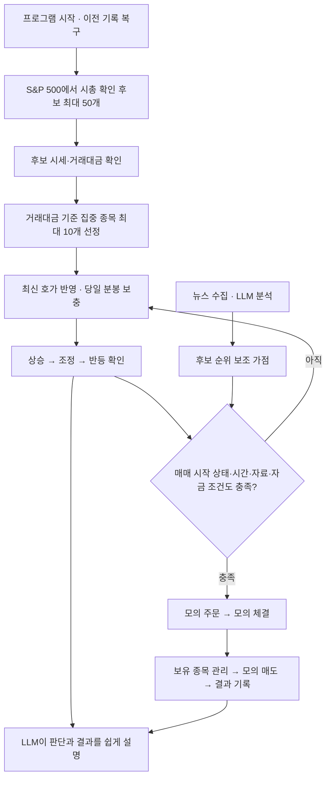

# SessionQuant

**OpenAI Codex를 이용한 바이브 코딩으로, 직접 기획한 주식 매매 전략과 AI 해설을 구현하는 개인 프로젝트입니다.**

미국 주식의 실제 시세를 받아 가상 자금으로 매매합니다. 사람이 규칙을 정하고, 프로그램이 종목을 골라 관찰하며, 조건이 맞으면 모의 매수·매도를 기록합니다. LLM은 뉴스와 프로그램의 판단을 사람이 이해하기 쉬운 말로 설명합니다.

성공 기준은 **“내가 정한 전략이 코드로 구현됐는가”, “AI를 어디에 활용했는가”, “프로그램이 의도한 순서대로 동작하는가”**입니다. 수익률 검증과 실제 투자 서비스 개발은 별도의 과제입니다.

## Codex로 어떻게 만들었나요?

이 프로젝트에서 ‘바이브 코딩’은 원하는 기능을 자연어로 설명하고, Codex와 함께 코드 작성·수정·검증을 반복하는 개발 방식입니다.

> 기획을 설명한다 → Codex가 코드를 작성한다 → 실행 결과를 확인한다 → 로그와 화면으로 문제를 찾는다 → 기획과 코드를 고친다.

사람은 목표와 매매 규칙을 결정하고 실제 사용 결과를 확인합니다. Codex는 구현, 오류 분석, 테스트, 문서 정리를 돕습니다. AI가 만든 코드도 자동 검사와 실행 기록을 통해 확인합니다.

| AI 활용 | 하는 일 |
| --- | --- |
| **개발 과정의 Codex** | 요구사항을 코드로 만들고 오류를 찾아 수정합니다. |
| **실행 중의 LLM** | 수집한 뉴스를 분석하고 시장·전략·모의매매 결과를 설명합니다. |

## 처음 기획에서 왜 바뀌었나요?

처음에는 소형주와 여러 매매 전략, 뉴스 위험 판단, 엄격한 데이터 검증까지 폭넓게 구현하려 했습니다. 실제 API와 클라우드 서버로 운영하면서 자료 준비와 원인 파악에 시간이 많이 든다는 문제가 드러났습니다. 목표를 **‘내가 기획한 동작을 설명하고 재현할 수 있는 프로그램’**으로 구체화했습니다.

| 처음 접근 | 실제로 겪은 제한 | 지금 선택한 방법 |
| --- | --- | --- |
| 여러 전략과 많은 조건을 함께 준비 | 매수되지 않는 이유를 한눈에 파악하기 어려움 | 단순 눌림목 전략 한 가지를 중심으로 시연·검증 |
| 과거 20일 같은 시간대 거래량을 필수로 비교 | 분봉 누락·출처·주식 분할 전후 거래량 기준을 확인하기 어려움 | 현재 권장 설정에서는 거래량 비교를 매수 필수 조건에서 제외 |
| 종목마다 현재 시세를 반복 요청 | 요청 제한, 순차 대기, DB 저장·계산 작업이 겹쳐 시세가 늦어짐 | 호가는 웹소켓으로 받고, 당일 분봉 보충은 기존 조회 방식 유지 |
| 순위가 바뀔 때마다 집중 종목 교체 | 한 종목의 흐름을 보다가 다른 종목으로 자주 바뀜 | 개장 기준 30분마다 최대 10개를 재선정하고 유효한 조정·반등 패턴은 유지 |
| 모든 기능과 진단 표를 메인에 표시 | 무엇을 보고 기다려야 하는지 이해하기 어려움 | 메인은 가격·전략 단계·자산·AI 설명, 상세 근거는 별도 화면 |
| 작은 서버와 짧은 백업 제한으로 운영 | DB 변경 로그가 디스크를 채웠고, 다른 날에는 백업 시간이 제한을 넘음 | 저장 정책·용량 점검·백업 절차를 개선하고 필요한 서버 자원 증설 |

웹소켓은 바뀐 시세를 바로 받는 통로입니다. 빠진 과거 분봉을 만들어 주거나, 전략 조건을 자동으로 충족시키는 기능은 아닙니다. 오래된 시세, 누락된 필수 분봉, 중복 주문은 계속 확인합니다.

전환 과정과 확인된 장애 원인은 [기획 변화와 현실적인 제한](docs/PROJECT_STORY.md)에 정리했습니다.

## 프로그램은 이렇게 돌아갑니다



LLM이 직접 주문을 보내지는 않습니다. 매수·매도는 코드로 정한 규칙이 결정합니다. 실제 주문은 발생하지 않으며, 실제 시세를 쓰는 모의매매와 가상 자료로 실행하는 재현 시나리오도 구분합니다.

메인 화면의 집중 감시 위에는 SPY(S&P 500)·QQQ(나스닥 100)·SOXX(미국 반도체 ETF)의 관측 가격과 최근 1시간 분봉 차트를 표시합니다. 차트 가운데 점선은 전 거래일 종가(0%)이며, 높은 구간은 위쪽 빨간색, 낮은 구간은 아래쪽 파란색으로 표시합니다. 전일 종가가 없으면 비교값과 차트를 준비 중으로 표시합니다. 이 카드들은 시장 흐름을 보는 참고용으로, 현재 눌림목 전략의 매수 조건에 영향을 주지 않습니다. SOXX는 필라델피아 반도체지수(SOX) 자체가 아닌 별도 ETF입니다.

집중 감시 카드에는 티커 아래 한글 종목명을 작게 표시합니다. 공급자의 한글 이름을 우선 쓰며 이전 기록은 등록된 이름으로 보완합니다.

보유 종목에는 평가 손익과 매입원가 대비 수익률(%)을 함께 표시합니다. AI 브리핑은 새 분석이 한도에 걸려도 마지막 설명과 그 기준 시각을 유지하며, 제한 사유를 따로 알려 줍니다.

### 1. 어떤 종목을 고르나요?

**후보 → 집중 감시 → 매수 대상**은 서로 다른 단계입니다.

1. **후보 최대 50개:** S&P 500 구성 종목 중 시가총액을 확인할 수 있는 종목을 큰 순서로 고릅니다. 시총 자료가 없는 종목은 제외하므로 전체 시장의 정확한 상위 50개를 보장하는 목록은 아닙니다.
2. **집중 감시 최대 10개:** 최신 현재가·거래대금 자료가 있는 후보를 거래대금 순으로 고릅니다. 거래대금은 ‘얼마나 큰 금액이 거래됐는지’입니다. 집중 종목이 됐다고 상승 추세나 매수 조건을 통과한 것은 아닙니다.
3. **매수 대상:** 집중 종목 중 전략과 주문 조건을 통과한 종목을 비교합니다. 한 번에 주문 검토로 넘기는 최종 후보의 상한은 5개이며, 현재 추천 설정은 **동시 보유 최대 3종목**입니다. 미체결 매수도 한 자리를 차지하며, 조건이 맞지 않으면 3종목을 억지로 채우지 않습니다. 집중 10개를 모두 매수하는 방식은 아닙니다.

집중 목록은 미국 정규장 개장 기준 30분마다 확인합니다. 예를 들어 미국 동부시간 09:30, 10:00, 10:30입니다. 유효한 조정·반등을 관찰 중인 종목은 먼저 유지할 수 있습니다. 자료가 늦을 때의 유예와 종목 교체 규칙도 따로 있습니다.

**이미 산 종목과 처리 중인 주문은 집중 목록에서 빠져도 계속 관리합니다.** 목록 교체 때문에 손절·매도 관리가 끊기지 않도록 구분했습니다.

### 2. 언제 매수하나요?

현재 권장 전략은 ‘오르던 주가가 잠시 쉬었다가 다시 오르는 구간’을 찾는 **단순 눌림목**입니다.

| 단계 | 쉬운 설명 | 현재 구현의 기준 |
| --- | --- | --- |
| **상승** | 최근 큰 흐름이 위쪽인가? | 마지막으로 끝난 15분봉의 마감 가격이 직전 15분봉보다 높음 |
| **조정** | 상승 뒤 잠시 내려오는 구간인가? | 반등 직전에 마감 가격이 낮아지거나 같은 5분봉이 1~4개 이어짐. 실제 하락이 한 번 이상 있고 하락 폭도 제한 안에 있어야 함 |
| **반등** | 다시 오르는 움직임이 확인됐나? | 마지막으로 끝난 5분봉의 마감 가격이 직전 봉의 최고 가격보다 높음 |

‘봉’은 일정 시간의 가격을 묶은 기록입니다. **끝나지 않은 봉의 순간적인 가격 움직임은 확정 신호로 쓰지 않습니다.** 세 조건은 매번 최신 자료로 다시 평가하므로, 앞서 상승이었다가 지금 하락이면 대기로 돌아갈 수 있습니다.

이 조건을 만족한 뒤에도 매매 시작 버튼, 매수 가능 시간, 최신 호가, 필요한 분봉, 잔액·보유 수·손실 한도를 확인합니다. 따라서 거래가 없는 날도 있을 수 있습니다.

현재는 지표 계산에 필요한 **당일 5분봉 15개와 개장 후 75분 대기 조건**이 남아 있습니다. 일반 거래일의 신규 매수 판단 시간은 미국 동부시간 **10:45 이상~13:30 미만**입니다. 집중 종목으로 뽑힌 시점부터 75분을 새로 세는 것은 아닙니다. 휴장·조기 폐장은 거래소 달력을 따릅니다.

정확한 조정 폭, 시간표, 예시와 코드 위치는 [종목 선정부터 매수·매도까지](docs/TRADING_PROCESS.md)를 참고하세요.

### 3. 매수한 다음에는 어떻게 하나요?

모의 주문을 냈다고 즉시 전량 체결됐다고 기록하지 않습니다. 실제 받은 호가와 설정된 체결 지연·비용 등을 바탕으로 체결을 모의 계산합니다. 일부만 체결되거나 취소되는 경우도 구분합니다.

보유 중에는 손실 제한, 이익 보호, 목표 수익, 매도 시간 규칙을 확인합니다. 현재 단순 눌림목 전략은 추가매수를 하지 않습니다. 초기 모의 자금 예시는 **100달러**이며, 실제 토스 계좌 잔액과 별도의 장부입니다. 모의 수수료와 체결 결과가 실제 증권사의 거래 결과를 보장하지는 않습니다.

### 4. LLM은 어디에 쓰이나요?

- **뉴스 분석:** 기업 뉴스의 긍정·부정·중립과 원문 근거를 확인합니다. 확인된 결과는 매수 후보를 비교할 때 보조 점수로 씁니다. 뉴스가 없거나 분석에 실패하면 가점을 주지 않습니다.
- **AI 설명:** 저장된 뉴스, 전략 조건, 모의 체결 기록을 바탕으로 ‘왜 기다리는지’, ‘어떤 조건이 맞았는지’를 설명합니다. 최소 10분 간격과 사용 한도가 있어 시세처럼 매초 바뀌지 않습니다.

기업 뉴스가 모든 종목에 매일 나오는 것은 아닙니다. 긍정 기사와 부정 기사가 함께 있어도 단순 평균을 내지 않으며, 확인된 부정 뉴스가 있으면 뉴스 가점은 0점입니다. **현재 권장 설정에서는 뉴스 가점 0점만으로 매수를 금지하지 않습니다.** 자세한 기준은 [전략과 LLM의 역할](docs/STRATEGY_LAB.md)에 있습니다.

## 화면에서는 무엇을 보면 되나요?

메인은 **자동매매 상태·모의 자산·집중 종목의 가격과 전략 단계·보유 종목·짧은 AI 설명**을 보는 화면입니다. 대기 이유는 개장 전, 자료 갱신, 전략 조건 미충족, 주문 제한 등으로 구분합니다. 이전 가격과 지난 분석을 현재 판단으로 표시하지 않도록 시각도 함께 보여 줍니다.

더 자세한 내용은 `시장·종목 → 매수 판단`, 주문과 체결은 `매매 내역`, 뉴스 원문과 AI 분석 근거는 `뉴스·LLM`에서 확인합니다. **자동매매 켜짐은 조건을 검사한다는 뜻이며, 계속 주문하고 있다는 뜻은 아닙니다.**

## 실행해 보기

설치가 처음이라면 [시작 안내](docs/GETTING_STARTED.md)를 먼저 읽으세요. Python 3.12 이상과 프로젝트 설치가 필요합니다.

| 해 보고 싶은 것 | 실행 방법 |
| --- | --- |
| API 키 없이 정한 규칙대로 동작하는지 확인 | 아래 재현 시나리오 명령 |
| 실제 시세와 뉴스를 받아 모의매매 | API·MySQL 설정 후 웹소켓 권장 프로필 실행 |
| 내 PC를 꺼도 서버에서 실행 | [GCP 운영 안내](docs/GCP_PAPER.md) |

```bash
# 가상 자료로 매수·매도·오류 상황 재현. 새 폴더에 report.html 생성.
python -m sessionquant strategy-lab --out data/my-first-check

# 실제 시세를 사용하되 거래는 모의로 진행. API와 MySQL 설정 필요.
python -m sessionquant run --config config/sessionquant.strategy-lab-websocket.example.yaml
```

이 문서의 **권장 설정은 명시적으로 지정하는 웹소켓 전략 실험 프로필**입니다. 설정 없이 실행한 CLI의 기본값이나 기존 GCP 환경 파일이 자동으로 이 설정으로 바뀌는 것은 아닙니다. 기존 서버는 [전환 절차](docs/WEBSOCKET_ROLLOUT.md)를 따릅니다.

GCP에서는 VM 켜기, 프로그램 업데이트, 매매 시작이 각각 다른 작업입니다. 새 코드가 없다면 매번 배포할 필요는 없습니다. 브라우저·휴대폰 연결이 끊겨도 서버 프로그램은 별도로 실행되며, 예약 종료·오류·직접 종료 여부는 확인해야 합니다. 클라우드 서버와 실제 LLM API 이용에는 비용이 들지만, 여기서 안내하는 매수·매도는 가상 자금으로 진행합니다.

## 용어가 낯설다면

| 용어 | 이 프로젝트에서의 뜻 |
| --- | --- |
| **시가총액** | 주가와 발행 주식 수로 계산한 기업·주식의 시장 규모 |
| **거래대금** | 주식이 거래된 금액의 합. 많이 거래되는 종목을 고를 때 참고 |
| **분봉·확정봉** | 몇 분 동안의 가격 기록·그 시간이 끝나 내용이 확정된 기록 |
| **호가** | 시장에서 사거나 팔겠다고 제시한 가격 |
| **체결** | 주문이 실제 거래로 성립한 것. 이 프로젝트에서는 모의 계산 |
| **손절** | 정한 손실 기준에 도달했을 때 매도하는 것 |
| **RVOL** | 현재 거래량을 과거 비슷한 시간대 거래량과 비교한 비율. 현재 권장 전략의 필수 조건은 아님 |
| **웹소켓** | 연결을 유지하고 서버가 보내는 새 데이터를 계속 받는 방식 |
| **CI / CD** | 코드를 자동 검사하는 과정 / 서버에 새 버전을 배포하는 과정. CI는 구성돼 있고 버튼식 CD는 추후 작업 |

VWAP, ATR, 슬리피지, 예열, DB, API, LLM 등은 [쉬운 용어 사전](docs/GLOSSARY.md)에서 설명합니다.

## 문서 읽는 순서

1. [기획 변화와 현실적인 제한](docs/PROJECT_STORY.md) — 왜 지금의 범위가 됐는가
2. [종목 선정부터 매수·매도까지](docs/TRADING_PROCESS.md) — 어떤 규칙으로 동작하는가
3. [시작 안내](docs/GETTING_STARTED.md) — 설치와 첫 실행
4. [매일 운영하고 결과 확인하기](docs/REALTIME_PAPER.md) — 켜기·관찰·종료
5. [개발 안내](docs/DEVELOPMENT.md) — 코드 구조와 검사 방법

[전체 문서 지도](docs/README.md)에서 설정·API·DB 참고 자료와 과거 기획을 찾을 수 있습니다. 예전 엄격한 전략, 최대 20개 집중 종목, REST 전용 수집 설명은 해당 시점이나 별도 프로필의 기록이며 위 권장 설정과 구분합니다. 이 저장소의 구현과 현재 운영 서버에 배포된 버전도 별도로 확인합니다.
