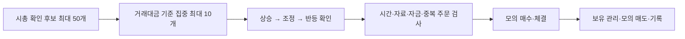

# SessionQuant

**직접 기획한 매매 전략을 OpenAI Codex와 함께 구현한 AI 바이브 코딩 프로젝트입니다.**

미국 주식의 실제 시세를 받아 **가상 자금으로 매수·매도**하고, 그 과정을 웹 대시보드에서 확인합니다. 실행 중에는 LLM이 뉴스를 분석하고 전략 판단을 쉬운 말로 설명합니다.

이 프로젝트의 목표는 높은 수익률보다 **“내가 정한 전략이 프로그램에서 의도대로 실행되는가”**를 확인하는 것입니다. 개인 프로젝트로 개발·운영 검증을 계속하고 있습니다. 저장소 이름 `pennyquant`는 초기 프로젝트명의 흔적입니다.

## 무엇을 볼 수 있나요?

- **집중 감시:** 어떤 종목을 보고 있고, 상승 → 조정 → 반등 중 어디까지 왔는지 표시합니다.
- **모의매매:** 가상 자산, 보유 종목, 손익·수익률, 매수·매도와 그 이유를 확인합니다.
- **시장 흐름:** SPY·QQQ·SOXX의 가격과 개장부터 수신한 흐름을 1분 간격 차트로 보여 줍니다.
- **AI 브리핑:** 수집한 뉴스, 저장된 전략 판단, 최근 모의매매를 한국어로 설명합니다.
- **대기 이유:** 조건 미충족인지, 자료 부족인지, 주문 제한인지 상세 화면에서 구분합니다.

휴대폰에서도 확인할 수 있습니다. 휴장·폐장 후에는 마지막 거래일의 저장 기록을 보여 주고, 확인하지 못한 종가는 ‘종가 미확인’으로 표시합니다. 화면 구성은 [대시보드 안내](docs/reference/MAIN_DASHBOARD.md)에 정리했습니다.

## Codex와 LLM은 어떻게 다른가요?

| 구분 | 역할 |
| --- | --- |
| **개발 도구인 Codex** | 자연어로 전달한 요구사항을 바탕으로 코드 작성·오류 분석·테스트·문서화를 돕습니다. |
| **프로그램 안의 LLM** | 뉴스의 의미를 분석하고, 저장된 판단과 매매 결과를 설명합니다. 직접 주문하지 않습니다. |
| **기획자** | 목표·규칙·화면을 정하고 실제 실행 결과를 확인하며 개선 방향을 결정합니다. |

개발은 **기획 → Codex 구현 → 직접 사용 → 화면·로그로 확인 → 수정·자동 검사**를 반복했습니다. AI가 구현했다는 사실과, 기획자가 직접 제안한 변화가 무엇인지 [기획과 문제 해결](docs/PROJECT_STORY.md)에서 구분해 설명합니다.

## 매매는 어떤 순서로 진행되나요?



1. **하루의 후보를 정합니다.** 토스가 제공하는 미국 상장 주식 중 시가총액을 확인한 종목을 큰 순서로 최대 50개 고릅니다. 하루 동안 유지하고 다음 거래일에 갱신합니다. ETF 등은 제외하며, 미국 시장 전체의 정확한 상위 50개를 보장하는 목록은 아닙니다.
2. **집중할 종목을 고릅니다.** 최신 자료가 있는 후보를 거래대금, 즉 주식이 거래된 **금액** 순으로 최대 10개 선정합니다. 전날 대비 거래량 증가율로 고르는 방식은 아닙니다. 개장 기준 30분마다 확인하고 유효한 조정·반등 패턴은 우선 유지할 수 있습니다.
3. **단순 눌림목 전략을 확인합니다.** 최근 두 15분봉의 마감 가격이 상승했고, 5분봉 1~4개가 조정한 뒤, 마지막 5분봉이 직전 봉의 최고가보다 높게 마감했는지 봅니다. ‘봉’은 일정 시간의 가격을 묶은 기록입니다. 조정 폭과 자료 조건도 확인합니다.
4. **조건이 맞을 때만 모의 주문합니다.** 매매 시작 상태·시간·신선한 호가·필요한 분봉·잔액·보유 한도를 검사합니다. 가상 초기 자금은 $100, 보유와 미체결 매수를 합쳐 최대 3종목입니다. 뉴스 분석 결과는 통과한 후보를 비교하는 보조 가점입니다.
5. **산 종목을 계속 관리합니다.** 집중 목록에서 빠져도 보유·미체결은 관리합니다. 손절, 목표 이익, 이익 보호, 시간 청산 등의 조건을 확인하고 결과와 이유를 남깁니다. 현재 단순 전략은 추가매수하지 않습니다.

현재는 지표 계산에 당일 5분봉 15개가 필요해 **개장 후 75분부터** 신규 매수를 판단합니다. 일반 거래일에는 미국 동부시간 10:45 이상~13:30 미만이며, 집중 목록에 들어간 뒤 75분을 새로 기다리는 것은 아닙니다. 조건이 맞지 않으면 거래가 없을 수 있습니다.

현재 웹소켓 모의 운영은 **매수·매도 모두 주문 시점 호가로 바로 모의 체결**을 시도합니다. 매수는 매도 호가, 매도는 매수 호가에 슬리피지와 수수료를 반영하며, 수량이 부족하면 가능한 만큼 체결하고 잔량은 새 호가를 기다립니다. 실제 증권사 체결을 보장하는 것은 아닙니다.

정확한 기준과 매수·매도 예시는 [매매 과정](docs/TRADING_PROCESS.md), 어려운 단어는 [용어 설명](docs/GLOSSARY.md)을 참고하세요.

## 사용한 기술과 구조

| 기술 | 쓰는 곳 |
| --- | --- |
| Python · pandas · NumPy | 데이터 처리, 가격 지표 계산, 전략 판단 |
| 토스 REST API · WebSocket | 분봉·종목 정보 조회와 실시간 호가·참고 ETF 체결가 수신 |
| OpenAI API | 뉴스 분석과 한국어 브리핑 |
| MySQL · SQLite | 운영 기록 저장 / 외부 연결 없는 테스트·재현 |
| Streamlit | PC·모바일에서 보는 대시보드 |
| Docker Compose · GCP · Cloud Storage | 앱·DB 실행, 서버 운영, 백업 |
| Tailscale | 같은 사설 네트워크에 연결한 기기의 대시보드 접속 |
| pytest · GitHub Actions | 변경 후 자동 검사(CI). 서버 배포는 수동으로 진행 |

**시세·뉴스 수집 → 전략·모의매매 엔진 → DB 기록 → 대시보드** 구조입니다. LLM은 뉴스와 기록을 읽어 분석·설명하고, 주문은 정해 둔 코드가 결정합니다. 웹소켓으로 호가를 받아도 매매용 분봉은 REST 조회가 필요합니다. 코드의 폴더별 역할은 [개발 안내](docs/DEVELOPMENT.md#코드의-흐름과-위치)에 있습니다.

## 처음 기획과 무엇이 달라졌나요?

처음에는 소형주·여러 전략·많은 뉴스와 거래량 조건을 다루려 했습니다. 실제 운영에서 API 호출 제한, 분봉 누락·갱신 지연, 종목별 뉴스 부족, 서버 저장량 증가를 겪으면서 목표에 맞게 범위를 줄였습니다.

| 직접 제안한 변화 | 바꾼 이유 |
| --- | --- |
| 핵심 전략을 상승 → 조정 → 반등으로 단순화 | 조건이 많아 왜 매매되지 않는지 이해하기 어려웠음 |
| 집중 10종목·개장 기준 30분 재선정 | 너무 적은 종목과 잦은 목록 교체 사이에서 관찰 기회를 확보 |
| 웹소켓 수신 도입 | 종목을 순서대로 조회하면서 시세가 늦어지는 문제 제기 |
| 메인 화면 카드·한글 이름·전략 단계·매매 이유 | 휴대폰에서도 현재 상태를 쉽게 파악하고 싶었음 |
| 하루 전체 흐름을 1분 간격으로 표시 | 최근 한 시간·촘촘한 1초 차트보다 하루 추세를 보고 싶었음 |
| 매매 기록은 보존하고 오래된 보조 자료는 정리 | DB 증가와 백업 지연을 줄이고 싶었음 |
| 휴장일에도 저장 기록 조회 | 장이 닫혀도 업데이트 결과와 지난 거래를 확인하고 싶었음 |

직접 제안한 내용, Codex가 구현·검증한 부분, 아직 확인할 문제는 [프로젝트 이야기](docs/PROJECT_STORY.md)에서 이어집니다.

## 실행해 보기

Python 3.12 이상에서 [설치 안내](docs/GETTING_STARTED.md)를 따라 설치한 뒤, API 키 없이 데모를 실행할 수 있습니다.

```bash
python -m sessionquant strategy-lab --out data/my-first-check
```

생성된 `report.html`을 엽니다. **합성 시세·가상 LLM 응답**으로 규칙을 확인하는 데모이며 실제 시장 성과가 아닙니다. 다시 실행할 때는 새 출력 폴더를 지정합니다.

실제 데이터를 연결하려면 토스·MySQL·뉴스·OpenAI 설정 후 다음 프로필을 명시합니다.

```bash
python -m sessionquant run --config config/sessionquant.strategy-lab-websocket.example.yaml
```

이 README는 **웹소켓 전략 실험 프로필** 기준입니다. 설정을 생략하면 다른 기본값을 읽을 수 있습니다. 기존 서버의 설정·장부는 [전환 안내](docs/WEBSOCKET_ROLLOUT.md)에 따라 확인하세요.

장전에는 뉴스를 수집·저장하고 중복을 제거합니다. 정규장에는 쌓인 기사부터 제한된 묶음으로 분석하며, 브리핑은 새 자료가 있을 때 최소 한 시간 간격으로 요청합니다. 뉴스 분석과 브리핑의 호출 관리는 분리하고 월 비용 한도는 함께 적용합니다.

장 마감에는 매매 종료 뒤 백업·자료 정리·최종 백업을 수행합니다. 낮 업데이트는 검증된 야간 백업을 재사용할 수 있고 자료 정리는 다음 마감으로 넘깁니다. 실행 절차와 재사용 조건은 [GCP 운영 안내](docs/GCP_PAPER.md)를 참고하세요.

## 확인된 범위와 다음 과제

실제 시세를 이용한 모의 매수·매도 기록과 자동 검사를 통해 동작을 점검하고 있습니다. 현재 안내하는 실행에서는 실제 증권사 주문을 보내지 않습니다. 수익성이나 장기 안정성을 검증했다는 의미는 아닙니다.

분봉 갱신 지연은 다음 장중에 계속 확인할 과제입니다. 최신 봉이 늦게 도착하면 제한된 재확인을 하고, 지연 시각·API·DB·계산 시간을 작은 진단 기록으로 보관합니다. **정상 수집에는 진단용 DB 작업을 추가하지 않고, 지연 기록은 전 종목 합산 5분에 최대 1건·최근 96건·256KiB로 제한**합니다. 저장된 자료 이상으로 과거 흐름을 만들어 내지는 않습니다.

**더 읽기:** [문서 목록](docs/README.md) · [매매 과정](docs/TRADING_PROCESS.md) · [기획과 문제 해결](docs/PROJECT_STORY.md) · [Windows CMD부터 GCP 접속](docs/GCP_PAPER.md#windows-cmd에서-시작하기) · [개발·검사](docs/DEVELOPMENT.md)
