# 실행 화면

실제 시세를 받아 **가상 자금으로 운영한 SessionQuant**의 화면입니다. 메인에서 흐름을 살펴보고, 상세 화면에서 시세 품질·뉴스 처리·일별 성과를 확인합니다.

[프로젝트 소개](../README.md) · [문서 지도](README.md) · [화면 항목과 표시 기준](reference/MAIN_DASHBOARD.md)

| 화면 | 확인할 내용 | 원본 PDF |
| --- | --- | --- |
| [메인 대시보드](#main) | 자산·시장 흐름, 집중 종목, 보유 종목과 매매 기록 | [메인](assets/screenshots/2026-11/main.pdf) |
| [모바일 실행 화면](#mobile) | 휴대폰에서 보는 자산 요약·집중 감시·보유·체결 카드 | 아래 이미지로 보기 |
| [시장·종목](#market) | 최신 호가, 분봉 준비 상태, 매수를 기다리는 이유 | [종목·시세 품질](assets/screenshots/2026-11/market-quality.pdf) |
| [뉴스·LLM](#news) | AI 설명, 기사 수집과 분석 진행 상황 | [뉴스·LLM](assets/screenshots/2026-11/news-llm.pdf) |
| [전략·백테스트](#backtest) | 저장된 평가 보고서와 일별 모의매매 성과 | [백테스트](assets/screenshots/2026-11/backtest.pdf) |

이미지를 누르면 크게 볼 수 있습니다. 아래는 2026년 11월에 제공된 운영 캡처이며, 화면별 기록 시점과 실행 버전은 서로 다릅니다. 현재 시세나 최신 배포 상태를 보여주는 화면은 아닙니다.

## 메인 대시보드

### 자산과 시장 흐름

프로그램의 실행 상태, 최근 시세 수신 여부, 관찰 중인 종목 수와 모의 자산을 한눈에 확인합니다. **일간 수익률과 총 수익률**을 나누고, 상승은 빨간색·하락은 파란색으로 표시합니다.

[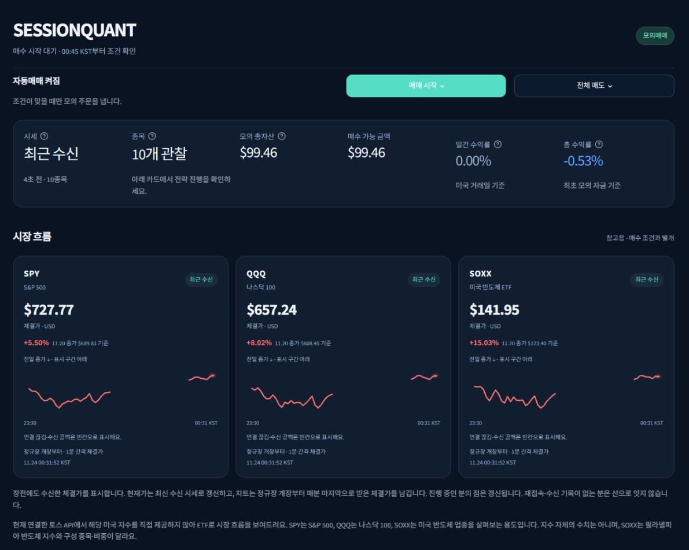](assets/screenshots/2026-11/main-overview.png)

SPY·QQQ·SOXX는 시장을 참고하기 위한 ETF입니다. 지수 자체의 값과 구분하며, 가격·전일 대비 등락률·수신 가격의 흐름을 함께 봅니다. 차트에 수신 공백이 있으면 빈 구간으로 남깁니다.

### 집중 감시

관찰하는 종목을 카드로 보여줍니다. 종목별 가격과 전일 대비 등락률 아래에서 **상승 → 조정 → 반등** 단계와 현재 대기 이유를 확인합니다.

[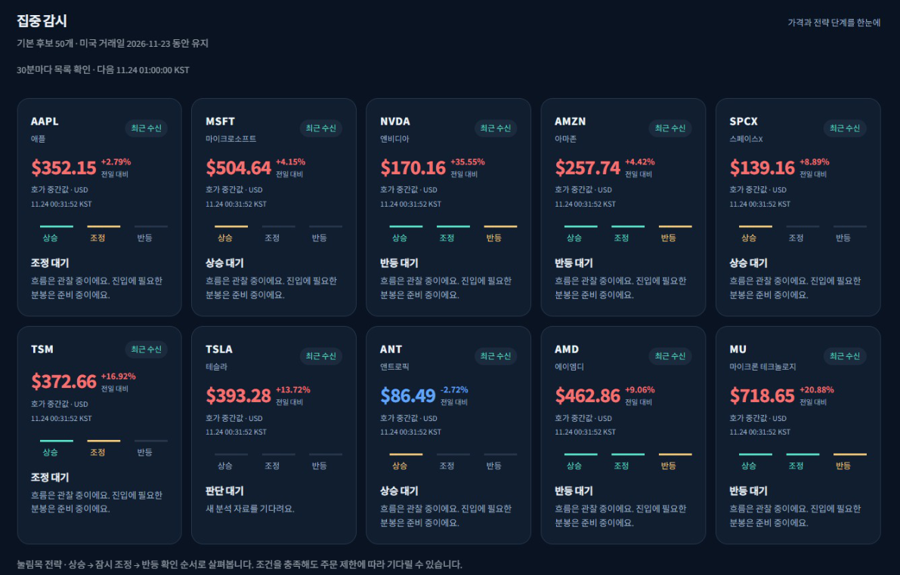](assets/screenshots/2026-11/main-watchlist.png)

‘반등 확인’은 전략 단계이며, 주문·체결 여부는 매매 기록에서 따로 확인합니다. ‘판단 대기’나 ‘자료 부족’도 표시해 가격 수신과 전략 판단의 준비 상태를 구분합니다. 함께 제공된 휴대폰 사진에서는 같은 카드가 두 열로 배치되고, 단계와 사유가 아래로 이어집니다.

### 보유 종목과 매매 기록

보유 종목의 평가액·평가손익을 보고, 바로 아래에서 최근 모의 체결을 확인합니다. 체결 카드는 **매수·매도, 종목, 금액, 수량, 가격, 시각과 기록된 사유**를 묶어 보여줍니다.

[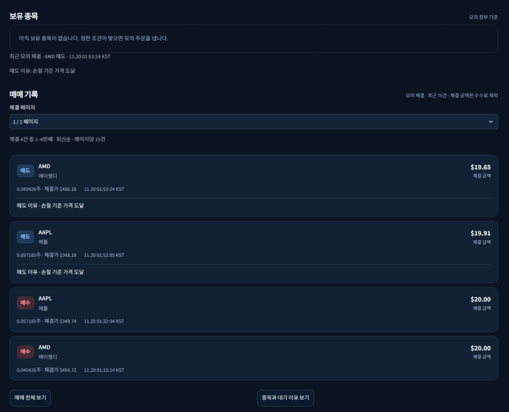](assets/screenshots/2026-11/main-trades.png)

이 PDF에는 체결 4건이 표시돼 있습니다. 상단의 옛 문구 ‘최근 75건’은 조회 상한을 뜻하며 실제 체결 건수가 아닙니다. 한 페이지에는 최대 15건, 최대 5페이지를 보여주는 구성입니다. 별도로 제공된 휴대폰 사진에는 이후의 TSM 매수가 포함된 체결 5건이 보입니다.

메인 전체 화면 보기 — 하단 AI 브리핑 포함

[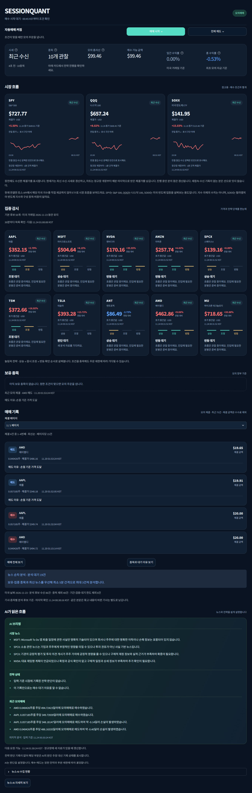](assets/screenshots/2026-11/main-full.png)

## 모바일 실행 화면

휴대폰에서 직접 확인한 화면입니다. 자산 요약은 두 열로, 집중 종목은 카드로 보여주고 보유·체결 기록은 아래로 이어집니다. 각 사진을 누르면 크게 볼 수 있습니다.

| 자산 요약 | 집중 감시 |
| --- | --- |
| [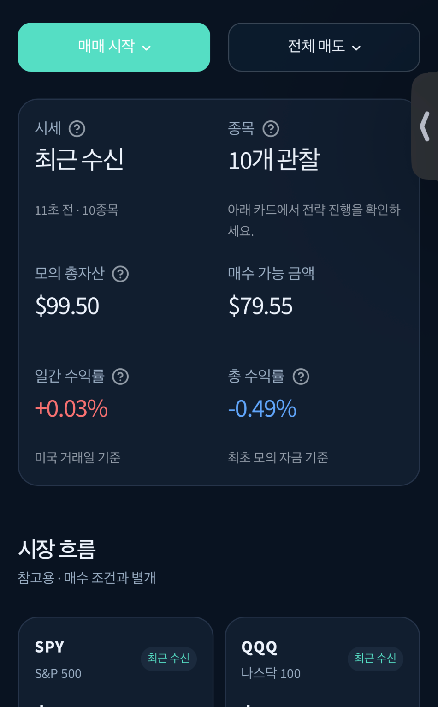](assets/screenshots/2026-11/mobile-overview.png) | [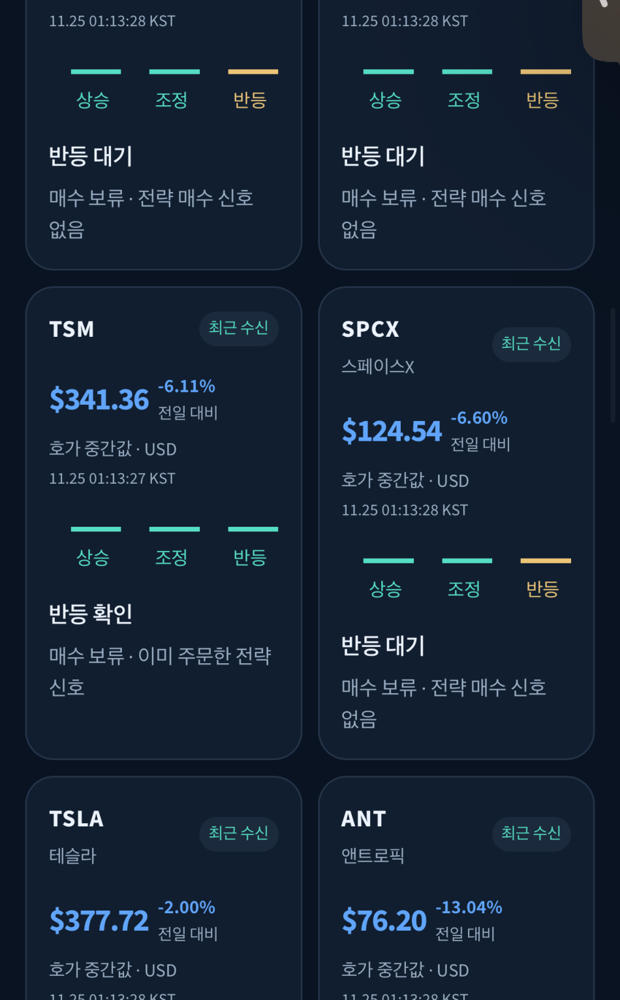](assets/screenshots/2026-11/mobile-watchlist.png) |
| 모의 총자산·매수 가능 금액과 일간·총 수익률을 구분합니다. | 가격·전일 대비 등락률 아래에 전략 단계와 대기 이유를 표시합니다. |

| 보유 종목 | 매매 기록 |
| --- | --- |
| [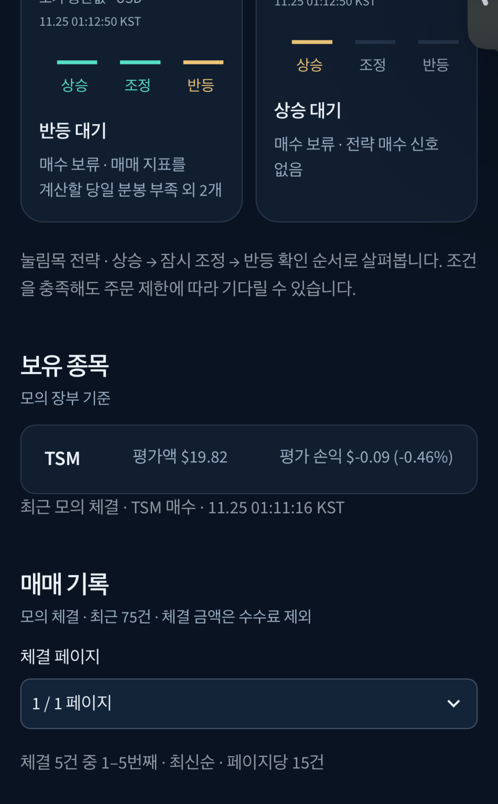](assets/screenshots/2026-11/mobile-holdings.png) | [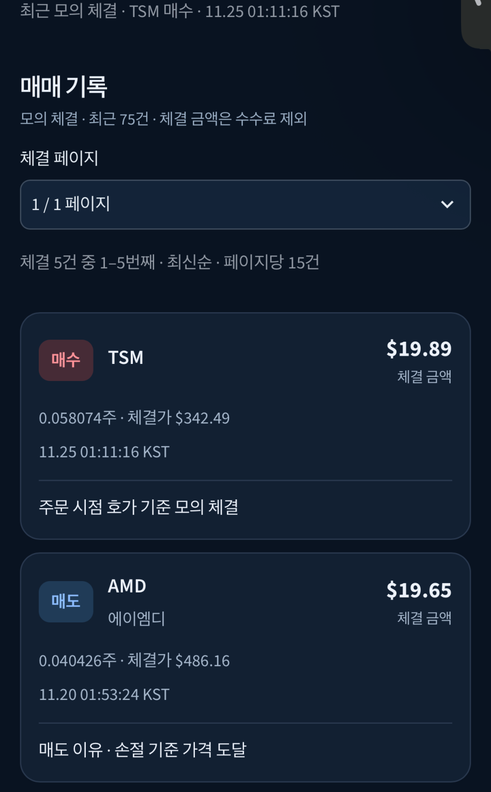](assets/screenshots/2026-11/mobile-trades.png) |
| TSM 보유 평가액·평가손익과 최근 매수 시각을 확인합니다. | 매수·매도를 색으로 구분하고, 수량·체결가·시각과 기록된 이유를 보여줍니다. |

사진의 기록 시각은 한국시간 11월 25일 01:13~01:24이며, 실제 체결 수는 5건입니다. ‘최근 75건’은 당시 조회 상한 문구입니다. 상태 표시줄과 브라우저 주소 영역은 제외하고 앱 화면을 옮겼습니다.

## 시장·종목 — 시세 품질

**메뉴: 시장·종목 → 시세·품질**

종목별 최신 호가와 분봉 준비 상태를 비교하는 화면입니다. 상단에는 확인된 종목 수, 아래에는 매수 차단 사유와 종목별 평가·수신 시각을 표시합니다.

[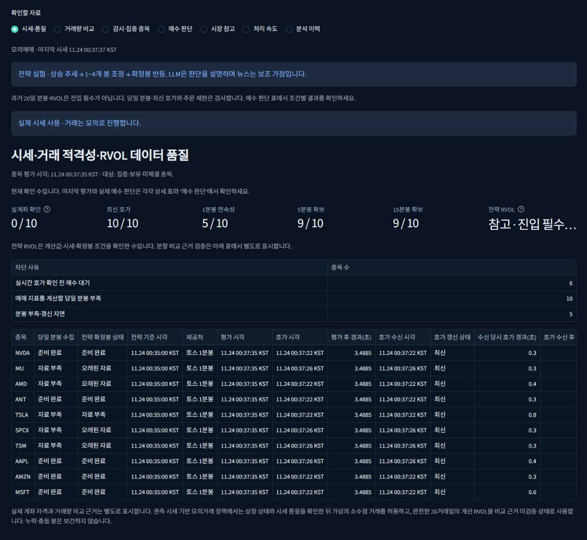](assets/screenshots/2026-11/market-quality.png)

이 캡처는 **최신 호가 10/10, 1분봉 연속성 5/10**으로 나옵니다. 가격은 도착해도 전략에 필요한 분봉이 부족할 수 있다는 점을 확인할 수 있습니다. 지연 원인을 조사할 때는 [운영 중 확인할 항목](REALTIME_PAPER.md)과 시장·종목의 ‘처리 속도’ 화면도 함께 확인합니다.

## 뉴스·LLM — 수집과 AI 설명

**메뉴: 뉴스·LLM → 기업 뉴스**

수집한 기사를 분석하고, 저장된 근거를 바탕으로 시장 상황·전략 판단·모의매매 결과를 설명합니다. AI 설명은 주문을 결정하는 기능과 분리돼 있습니다.

[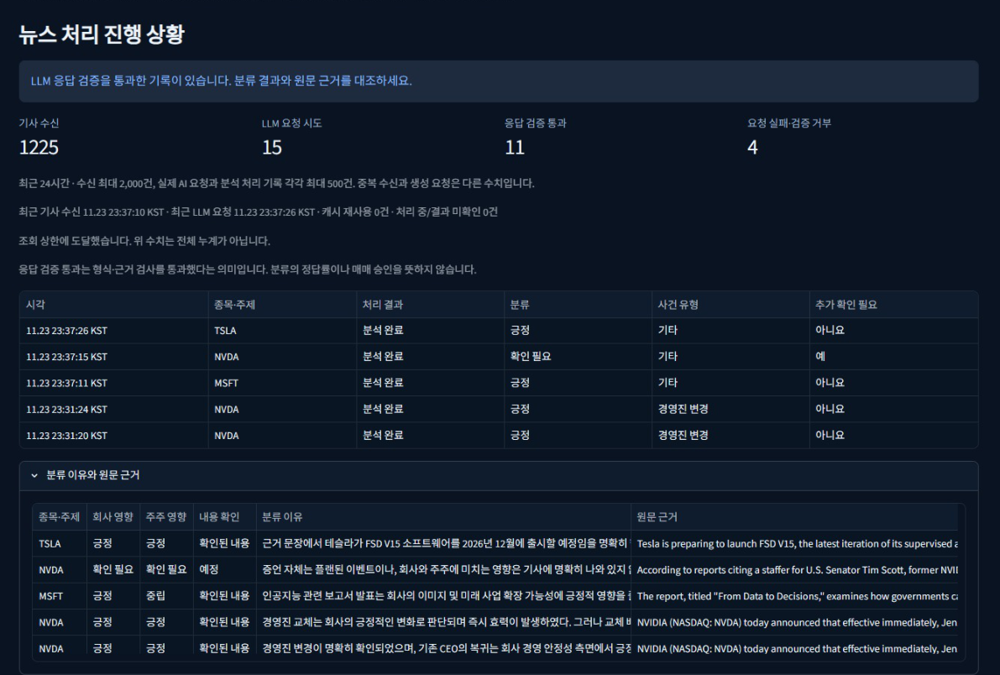](assets/screenshots/2026-11/news-processing.png)

| 화면에서 보는 것 | 의미 |
| --- | --- |
| AI 설명 | 시장·전략·매매 결과를 구분한 설명과 작성 시점·근거 |
| 뉴스 처리 진행 상황 | 기사 수신, AI 요청, 응답 검증, 실패 건수를 각각 표시 |
| 기사·수집원별 상세 기록 | 어떤 기사가 들어왔고 분석이 어디까지 진행됐는지 확인 |

기사 수신 건수와 AI 호출 횟수는 다른 수치입니다. 화면에 표시한 조회 범위·최대 건수도 실제 수집 제한과 구분합니다.

뉴스·LLM 전체 화면 보기 — AI 설명과 수집원별 기록 포함

[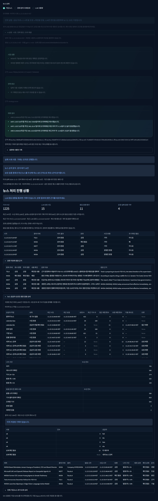](assets/screenshots/2026-11/news-llm-full.png)

원본 캡처 상단 일부는 어둡게 표시돼 있습니다. 설명 내용과 표시 상태를 바꾸지 않고 그대로 옮겼습니다.

## 전략·백테스트 — 일별 모의매매 성과

**메뉴: 전략·백테스트**

저장된 평가 보고서를 불러오는 영역과, 운영 중 쌓인 모의 장부의 일별 성과를 함께 볼 수 있습니다. 첨부 화면의 그래프는 **과거 가격으로 새로 계산한 백테스트 결과가 아니라 저장된 모의매매 성과**입니다.

[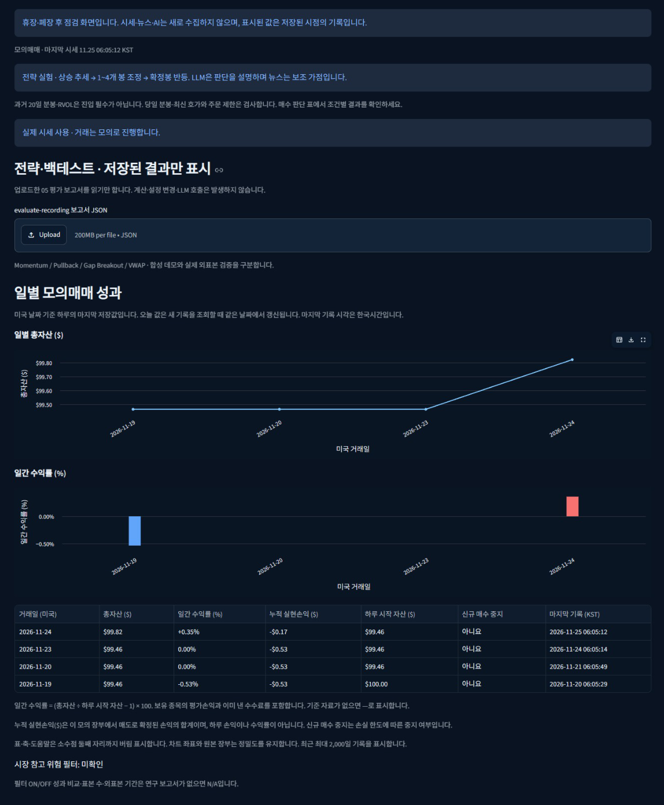](assets/screenshots/2026-11/backtest.png)

| 표시 | 읽는 방법 |
| --- | --- |
| 일별 총자산 꺾은선 | 미국 거래일별 마지막 저장 자산, 달러($) 기준 |
| 일간 수익률 막대 | 하루 시작 자산 대비 변화, 퍼센트(%) 기준 |
| 거래일별 표 | 총자산·수익률·누적 실현손익·하루 시작 자산·마지막 기록 시각 |

이 화면은 장 마감 후 저장 자료를 확인한 캡처입니다. 모의 성과와 짧은 운영 기록만으로 전략의 수익성이나 장기 안정성이 검증됐다고 해석하지 않습니다.

## 이미지 출처

사용자가 제공한 `세션퀀트-메인.pdf`, `세션퀀트-종목,시세품질.pdf`, `세션퀀트-뉴스,LLM.pdf`, `세션퀀트-백테스트.pdf`와 모바일 사진 4쪽을 담은 `png2pdf.pdf`를 이미지로 변환했습니다. 읽기 쉽도록 PDF의 바깥 여백을 줄이고, 긴 화면은 영역별로 나눴습니다. 가격·문구·차트는 수정하지 않았으며 위 표에서 데스크톱 화면의 원본 PDF를 열 수 있습니다. 모바일 사진에서는 상태 표시줄·브라우저 주소 영역을 제외했습니다.
