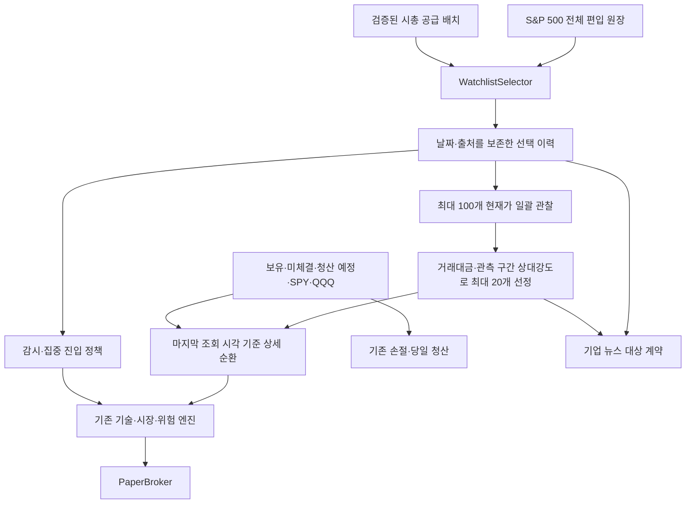

# 단계 01 — 시총 감시 100종목과 집중 분석 최대 20종목

구현 범위는 PAPER_LOCAL의 선정·수집·조회 구조다. S&P 500 전체 편입 원장은 유지하고 새 시총 감시·집중 목록을 별도로 관리한다. 이번 작업에서 실제 주문을 실행하지 않았으며 단계 02~10, GCP를 함께 구현하지 않았다.

## 현재 완료 상태와 외부 차단 항목

선정·검증·기록·공정 조회·기존 엔진 진입 차단·화면·과거 선택 이력 계약은 합성 입력과 모의 HTTP로 검증한다. **실제 동일 기준일 USD 발행사 시총 공급 자료 연결과 사용자 토스 응답시간 검증은 보류 상태다.** 자료가 없으면 `UNKNOWN`, 검증 일부 누락이면 `PARTIAL`이며 신규 진입을 허용하지 않는다. 임의의 100종목으로 대체하지 않는다.

기존 `sessionquant/config/rss_top100.json`은 RSS 등록에 사용한 반올림·복수 클래스 스냅숏이다. 실제 기준 시각·발행사 총액·대표 티커 유동성 검증이 부족하여 운영 감시목록으로 자동 변환하지 않는다. 기존 RSS 피드 주소와 검증 기록은 보존한다.

## 공식 명세 확인과 공급 어댑터

2026-11-14 [토스 공식 OpenAPI](https://openapi.tossinvest.com/openapi-docs/latest/openapi.json) 버전 1.2.28을 확인했다.

- `prices`와 `stocks`는 최대 200개 일괄 조회를 지원한다. 현재가에는 시각·통화·가격이 있으며 거래대금/RVOL이 있다는 가정을 하지 않는다.
- 종목 기본정보에는 발행주식수가 있지만 USD 발행사 총 시총·시총 기준 시각을 제공한다고 확인하지 못했다. 주가×발행주식수로 값을 생성하지 않는다.
- 섹터 종목 응답의 시총은 미국 종목도 KRW 환산·일별 갱신 필드다. 동일 기준일 USD 발행사 총액과 동등하다고 취급하지 않는다.
- 시장 거래대금 랭킹은 관찰 후보의 실제 거래량·거래대금에만 사용한다. 시가총액 순위와 구분하고 USD·시각을 검사한다.
- 시세 조회의 실제 요금·계좌별 지연·허용량은 사용자 계정에서 미검증이다. 기존 공용 1 TPS 제한과 주기별 읽기 예산을 보수적으로 적용한다. 새 유료 공급자에 가입하거나 과금을 시작하지 않았다.

`MarketCapProvider`는 검증 완료된 정규화 배치를 반환하는 인터페이스다. 현재 `FileMarketCapProvider`가 허가된 공급자의 로컬 JSON 내보내기를 읽는다. 아직 선정하지 않은 공급자의 엔드포인트·요금·발행사 시총 정의를 확인된 것으로 구현하지 않았다. 추후 실제 공급자를 연결할 때 이 인터페이스만 교체한다.

## 입력 자료 계약

[입력 형식 예시](../examples/market_cap_input.example.json)는 **의도적으로 미확인·빈 값**을 담는다. 실제 시총 표본이 아니며 그대로 넣어도 거래를 허용하지 않는다. 사용 권한·필드 정의·원본 확인을 마치지 않고 `source_verified`, `issuer_verified`, `data_status`를 통과용으로 변경하지 않는다.

검증된 파일을 `data/market-cap-input.json` 또는 설정의 `market_cap_input` 경로에 준비한다.

| 필드 | 요구사항 |
|---|---|
| `schema_version` | `1` |
| `source` / `source_documentation` | 검증한 공급자·정의·이용 권한 근거. 인증정보 없는 공개 설명 |
| `source_verified` | 실제 검증 완료 여부 |
| `market_cap_basis` / `currency` | `issuer_total` / `USD`로 통일 |
| `as_of_at` | 동일 기준 시각. 시간대를 포함한 ISO 8601 |
| `received_at` / `known_at` | 원본 수신·확인 가능 시각. `as_of_at <= received_at <= known_at` |
| `synthetic` | 실제 운영은 `false`. 합성 입력은 운영에서 차단 |
| `observations` | 현재 편입 티커 전체를 포함하는 배치. 누락 시 전체 순위 확정 불가 |
| 행별 `ticker` | 실제 편입 티커와 정확히 일치. 중복 금지 |
| `market_cap_usd` | 양의 유한 Decimal 문자열. 음수·결측·불리언·NaN 금지 |
| `issuer_id` / `issuer_verified` | 검증된 발행사 식별자와 확인 결과 |
| `data_status` | 원본 검증 완료 행은 `VERIFIED`; 미검증 행은 선정 근거로 사용하지 않음 |

행별 시각·통화·시총 정의가 있으면 배치와 일치해야 한다. 미래·역순 시각, 잘못된 정의, 7일 이상 지난 자료로 새 정상 목록을 만들지 않는다. 구성 원장도 별도로 최신성을 검사한다.

동일 발행사 주식 클래스가 여러 개면 총액이 동일한지 확인한다. 두 숫자가 다르면 합산하거나 최댓값으로 고르지 않고 정의 충돌로 처리한다. 대표 티커에는 `data_supported`, `representative_dollar_volume_usd`, `representative_as_of_at`, `representative_evidence_source`가 필요하다. 검증된 지원·유동성 근거로 하나만 선택한다. 이는 계좌 소수점 거래 적격성 확인과 다른 정보다. 근거가 없으면 UNKNOWN이며 두 클래스를 임의로 묶지 않는다.

시총 내림차순·동률 티커순으로 최대 100개 티커를 선택한다. 일부 원본이 누락되면 남은 표본 내 순위는 표시할 수 있지만 전체 상위 100의 확정 순위로 승인하지 않는다. 신규 검증이 실패해도 이전 검증 이력을 덮어쓰지 않는다. 유효기간이 남은 기존 목록은 원래 기준일로 유지하고 만료되면 진입을 차단한다.

## 실제 연결 경로



운영 `run`은 `WatchlistManager`를 복구하고 현재 보유·열린 주문·청산 의도의 종목을 별도로 넘긴다. 토스 클라이언트를 추가 생성하지 않는다. 100개 관찰은 현재가 일괄 조회이며, 개별 종목 전체의 호가·분봉을 매 10초 수집한다는 뜻이 아니다.

집중 후보는 최신 USD 거래대금·거래량과 종목/SPY의 동일 관측 구간 가격 변화가 확인되어야 한다. 이 값은 당일 수익률·정식 RVOL·ATR의 대용값이 아니다. 첫 조회라 비교 구간이 없거나 랭킹에 없는 종목은 임의 점수로 채우지 않는다. 데이터가 부족하면 20개보다 적게 또는 0개를 선택한다. 최소 300초 유지 정책은 여전히 최신 근거가 있는 후보에만 적용한다. 만료·목록 변경은 즉시 제외하며 과거 분봉은 삭제하지 않는다.

집중 순환은 실제 조회 시도를 마지막으로 한 시각이 오래된 종목부터 선택한다. 실패·호가만 조회한 경우도 시도 시각을 저장하여 재시작 시 A-티커부터 다시 시작하지 않는다. 이력 원장은 PAPER DB의 제어 레코드에 저장한다.

| 설정 | 기본값·의미 |
|---|---|
| `watchlist_enabled` | `true`; 새 운영 경로의 진입 정책 적용 |
| `watchlist_size` / `focus_size` | 최대 100 / 최대 20 |
| `selection_method` | `market_cap_top` |
| `watchlist_refresh_days` | 7; 만료 시점에는 더 일찍 재확인 |
| `market_cap_input` | 검증 공급 자료 파일 |
| `symbols_per_cycle` | 집중 후보 중 상세 조회 상한 2. 기존 설정은 계속 읽음 |
| `light_refresh_seconds` | 일괄 관찰 시도 최소 30초 |
| `ranking_refresh_seconds` | 거래대금 랭킹 시도 최소 60초 |
| `max_api_calls_per_cycle` | 주기별 읽기 최대 24회. 읽기 재시도 포함, OAuth 발급 별도 |
| `watchlist_data_max_age_seconds` | 관찰 근거 최대 120초. 기존 호가 30초·확정봉 검사는 별도 |
| `focus_min_hold_seconds` | 확인된 집중 후보의 최소 유지 300초 |

[설정 예시](../config/sessionquant.watchlist.example.yaml)를 제공한다. 기존 `config/sessionquant.yaml`을 덮어쓰지 않았으며 새 필드는 기본값으로 적용된다. `watchlist_enabled: false`는 이전 모의 연구 경로 비교용이고 운영 검증 완료를 의미하지 않는다.

429는 관리형 수집 주기에서 즉시 중단하고 Retry-After(초·HTTP 날짜)를 따른다. 단계 02부터는 위험 호가·분봉을 먼저 엔진에 전달한 뒤 후보와 과거 페이지를 조회한다. 짧은 주기를 보장하지 않으며 실제 지연·예산 소진·최종 성공/시도 시각을 표시한다. 최신 자료가 없으면 신규 진입을 차단한다. 변경된 호출·시간 예산과 지연 시 처리 근거는 [단계 02](STAGE02_MARKET_DATA.md)를 따른다.

## 뉴스·RSS의 단계 06 계약

`news_targets()`는 `company_allowlist`(유효 대표 티커 최대 100), `focus_candidates`(최대 20), `risk_priority`(보유·열린 주문·청산), `analysis_symbols`, `macro_independent`를 제공한다. 기존 운영 뉴스 호출에는 이 우선대상 목록을 전달한다. 기존 NewsPipeline의 개별 요청 상한은 유지하므로 위험 종목 우선이며 모든 집중 후보의 동시 분석을 보장하지 않는다.

공식 RSS를 재탐색·100개 생성하거나 기존 피드의 검증 상태를 완화하지 않았다. 상위 100 밖의 보유 종목도 위험 우선대상에서 유지한다. SEC 자동 CIK 매핑과 미등록 RSS 처리는 기존 서비스가 담당한다. 거시 뉴스 수집기는 기업 대상 집합과 독립적으로 동작한다. 공급자별 오류·주기·RSS 품질의 본격 개편은 단계 06에 남긴다.

## 조회·갱신·과거 재생

```powershell
# 현재 상태: 외부 시세·주문·LLM 호출 없음
.\venv\Scripts\python.exe -m sessionquant watchlist-status

# 검증된 시총 파일과 최신 편입 원장을 준비한 뒤, 운영 엔진 종료 상태에서 갱신
.\venv\Scripts\python.exe -m sessionquant watchlist-refresh

# 기존 메인 화면으로 모의 운영. 시작 전에는 신규 매수 대기
.\venv\Scripts\python.exe -m sessionquant run --config config/sessionquant.yaml

# 실제 수집 당시의 선택 이력 내보내기. 기존 파일 덮어쓰기 금지
.\venv\Scripts\python.exe -m sessionquant watchlist-export --output data/watchlist-history.json

# 선택 당시 알려진 감시·집중 목록으로만 재생
.\venv\Scripts\python.exe -m sessionquant replay --input data/market.jsonl --universe data/sp500-history.json --watchlist-history data/watchlist-history.json --db data/replay-with-watchlist.db
```

`watchlist-refresh`는 파일/DB만 사용하며 실행 중 작성자와 같은 잠금을 잡는다. 실제 시세 수집이나 주문을 시작하지 않는다. 입력 파일이 없으면 UNKNOWN을 기록한다. 이미 검증한 과거 스냅숏을 현재 날짜로 소급하지 않는다. 이력은 새 제어 키에 추가하며 기존 이벤트·주문 ID와 장부를 수정하지 않는다. 별도 SQL 마이그레이션은 필요 없다.

과거 선택은 `known_at <= 재생시각`인 스냅숏과 집중 근거의 `valid_until`만 허용한다. 새 스냅숏의 ID와 당시 집중 기록도 일치해야 한다. 이력 파일이 변경되면 같은 재생 장부 복구를 거부한다. 기존 이력 옵션 없는 `demo/replay/backtest`는 과거 연구 정책의 호환 경로이며 100→20 효과를 검증한 결과로 주장하지 않는다. 비교 백테스트의 확대는 단계 05에서 수행한다.

## 요구사항·검증 추적

| 요구사항 | 코드·검증 |
|---|---|
| 전체 원장과 시총 선택 분리·결정적 순위 | `watchlist/capitalization.py`, `test_watchlist_selection.py` |
| 누락·통화·시각·중복·클래스·정의 충돌 | 동일 테스트의 비정상 입력·대표 티커 검증 |
| 공급자 실패·403/429·빈 응답·주간 갱신 | 공급자 모의 응답·기존 ID/시각 불변 검사 |
| 100→20·자료 없으면 0·미확인 권한 유지 | 집중 점수·UNKNOWN·최소 유지 검사 |
| 위험 우선·공정 순환·재시작 복구 | `test_watchlist_source.py`의 보유 외부 종목·다음 조회 검사 |
| 실제 재시도 예산·429 대기 | 모의 HTTP 요청 수와 Retry-After 검사 |
| 신규 차단과 기존 청산 분리 | `test_watchlist_integration.py`의 유효 전략 차단·매수 후 당일 매도 유지 |
| 기업 대상과 거시 분리 | 감시목록 미확인에서도 공식·Treasury·GDELT·FRED 호출 유지 |
| 현재와 과거 구분·미래 이력 차단 | 화면 상태·합성 경고·과거 선택 이력 검사 |
| 휴장·DST·조기 폐장·미완성 봉 | 기존 `test_session_market.py`, `test_session_portfolio.py`, `test_trading_controls.py` 회귀 |

실제 동일 기준일 시총 공급자·이용권한·원본 정확성, 대표 티커 유동성 근거, 토스 실제 응답시간/배치 누락, 단계 02의 RVOL·계좌 소수점 적격성은 미검증이다. 시총 입력만 연결했다고 실제 주문 가능성이 확인되는 것은 아니다. 다음 단계의 실사용 전에는 이 차단 항목을 먼저 확인한다.

## 변경 파일과 검증 결과

| 영역 | 변경 파일 |
|---|---|
| 선정·이력·대상 계약 | `sessionquant/watchlist/__init__.py`, `capitalization.py`, `selection.py`, `budget.py`, `commands.py` |
| 운영 연결·호출 제한 | `sessionquant/market/source.py`, `sessionquant/collectors/common.py`, `sessionquant/session_runtime.py`, `sessionquant/session_engine.py` |
| 설정·명령 | `sessionquant/session_config.py`, `sessionquant/cli.py`, `config/sessionquant.watchlist.example.yaml`, `examples/market_cap_input.example.json` |
| 화면 | `sessionquant/dashboard/session_app.py`, `sessionquant/dashboard/watchlist_panel.py` |
| 자동 검사 | `tests/watchlist_fixtures.py`, `tests/test_watchlist_selection.py`, `tests/test_watchlist_source.py`, `tests/test_watchlist_integration.py`, `tests/test_mysql_integration.py` |
| 안내 | `README.md`, `docs/SESSIONQUANT_CURRENT.md`, `docs/STAGE01_WATCHLIST.md`, `docs/COMPANY_RSS.md`, `docs/NEWS_SETUP.md` |

2026-11-14 검증 결과:

- `python -m pytest -q`: 격리 MySQL 8을 선택한 최종 실행에서 **682개 통과, 실패 0, 제외 0**(44.25초). 기존 pandas 시간대 변환 경고 8개는 남아 있다.
- `python -m ruff check sessionquant tests`, `git diff --check`: 통과.
- `python -m sessionquant doctor`, `python -m sessionquant --help`: 통과. Python 3.12, PAPER_LOCAL, 실제 주문 비활성화 확인.
- `uv build --wheel` 및 소스 디렉터리 외부에서 wheel의 새 모듈 가져오기·`doctor`: 통과.
- 격리 SQLite 설정으로 `watchlist-status`, `watchlist-refresh`: 입력 부재 시 오류 종료 대신 `UNKNOWN`, 실제 주문 비활성화 반환 확인.
- 선택 MySQL 검사는 전용 테스트 서버와 무작위 네임스페이스만 사용했다. 사용자 DB·거래 장부에 접근하지 않았고 실제 주문·유료 LLM 호출도 하지 않았다. 감시 자료는 합성 fixture이며 실제 시총 선정 성공으로 계산하지 않는다.

**판정: 코드·모의/격리 DB 검증 완료, 실제 데이터 운영 검증은 부분완료.** 동일 기준일 시총 공급 자료와 실제 수집 지연을 확인하기 전에는 단계 01의 실사용 완료 및 다음 단계 운영 승인을 보류한다. 단계 00의 전체 CI도 별도 미완료 항목이다.
