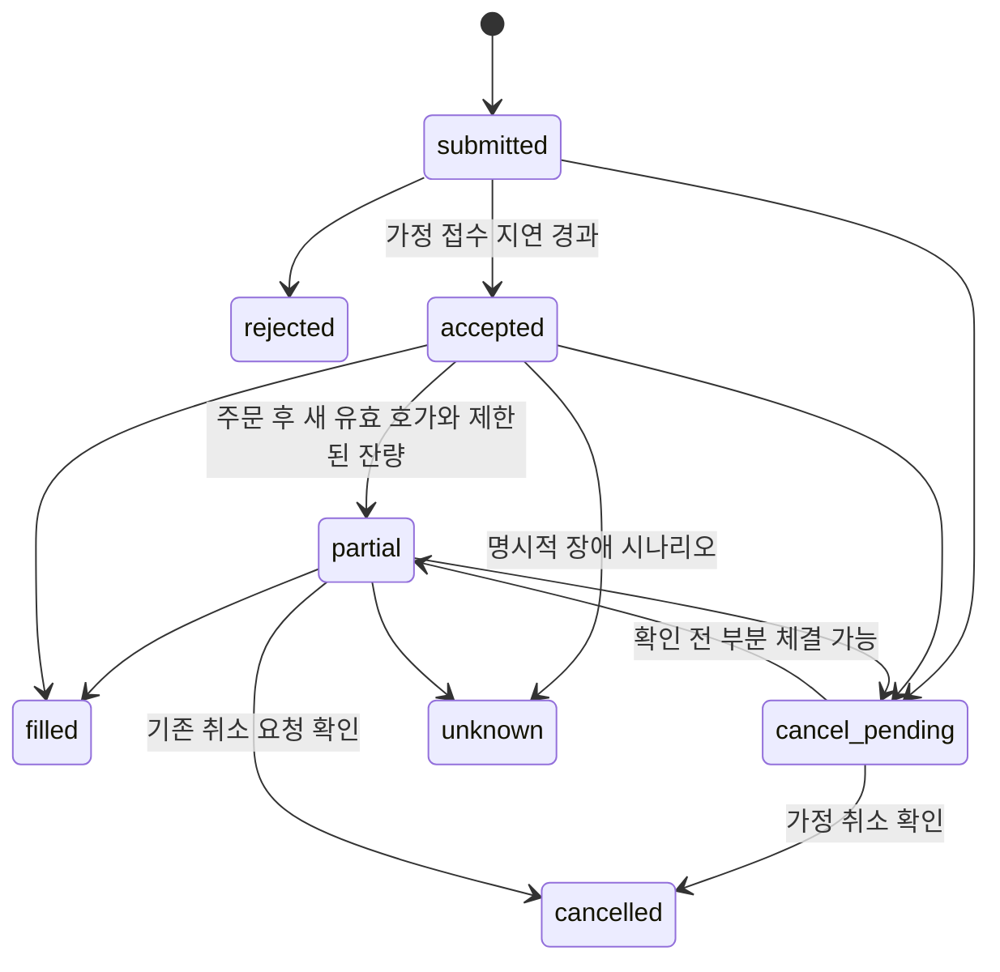

# 단계 03 — 소수점 Paper 시장가 체결 근사

기준 코드는 단계 02 `0b9bf40` 이후다. 이번 변경은 Paper 체결·기록·보고서에 한정하며 실제 주문 어댑터·계좌 활성화·전략 최적화를 구현하지 않는다. **새 Paper 기본값은 `market_v2`, 이전 가격제한 연구 모델은 `legacy_limit_v1`이다.**

## 무엇이 달라졌는가

이전 모델은 매수의 `ask×(1+slippage)`, 매도의 `bid×(1-slippage)`를 내부 제한 가격과 비교했다. 다음 시세가 불리하면 체결을 건너뛰고 반등 시세를 기다릴 수 있었다. 새 모델은 이 내부 값을 **계획용 참조 가격**으로만 유지하며 시장가 체결에 상한·하한으로 적용하지 않는다.

새 모델은 매수 시 실제 체결 수량을 금액 예산에서 계산하고, 매도 시 보유 소수점 수량을 기준으로 한다. 불리한 갭도 체결 가격에 반영한다. 주문 금액은 고정이므로 상승 갭의 매수 수량은 줄어든다. 매도 갭에서는 손실을 실현할 수 있다. 갭 발생 시 계획 단계의 종목 손실 예산을 보장할 수 없으며, 손절선을 낮추거나 불리한 체결을 취소하여 손실을 숨기지 않는다. 기존 손절·일일 손실·당일 청산 관리는 유지한다.

## 실제 토스 명세와 모의 가정

2026-11-14 [공식 OpenAPI JSON](https://openapi.tossinvest.com/openapi-docs/latest/openapi.json) 버전 1.2.28을 다시 확인했다. 공개 명세 GET 외 실제 계좌/주문 API는 호출하지 않았다.

| 항목 | 공식 명세에서 확인 | Paper 처리·한계 |
|---|---|---|
| 금액 매수 | 미국 MARKET의 `orderAmount`, 수량은 체결 시 결정 | Decimal 금액에서 수량 계산. 금액을 수량으로 미리 고정하지 않음 |
| 소수점 수량 매도 | 미국 MARKET+SELL, 최대 소수점 6자리 | `0.000001` 수량 단위. 초과 정밀도는 거부하며 조용히 자르지 않음 |
| 가격 | MARKET에는 `price` 전달 불가 | `OrderIntent.limit_price`는 호환·위험 계획 참조값이며 새 체결의 보호 가격이 아님 |
| 시간 | 정규장 개장부터 종료 1시간 전까지 금액/소수점 주문 접수 | 거래소 달력·DST·조기 폐장에 따라 제출 검사. 전략의 더 짧은 진입 창도 계속 적용 |
| DAY | 정규장 종료 시 잔여 주문 취소 | 확인된 모의 진행 주문은 DAY 만료 취소. 미확인 주문은 시계만으로 확인 상태를 만들지 않음 |
| 최소 금액 | 이 명세만으로 계좌별 최소 금액을 확정하지 못함 | 기본 `$1`은 기존의 모의 설정. 실제 최소금액 확인 완료로 표시하지 않음 |
| 금액 자릿수 | 명세는 decimal 문자열·길이 30자. 계좌별 금액 단위 추가 확인 필요 | 기존 내부 어댑터와 일치하는 센트 단위 가정 사용 |
| 체결 지연·배분 | 공개 명세로 실제 매칭·배분·확정 시간을 알 수 없음 | 기본 접수/실행 최소대기 1초, 호가 잔량 참여율 10%라는 명시적 가정 |
| 미체결 취소 | 실제 취소 요청과 확정은 다름 | 기본 취소 지연 0초. 설정으로 지연과 취소 전 체결 경쟁을 검사 가능 |
| 접수 마감 뒤 체결 | 접수 마감과 실제 DAY 체결 종료가 같다고 확정할 수 없음 | 보수적 모의 가정으로 종료 1시간 전 이후 호가에서는 체결하지 않음. 실제 서버 동작 재현 주장이 아님 |
| 비용 | 실제 계좌 수수료·규제 비용은 별도 확인 필요 | 기존 모의 요율을 유지하고 주문 누적 수수료를 항목별 기록. 실제 청구액으로 표시하지 않음 |

실제 증권사는 가격 개선·주문 라우팅·부분 체결·취소 경쟁·소수점 배분 방식을 다르게 처리할 수 있다. 위 가정을 공개되지 않은 매칭 알고리즘의 재현이나 체결 보장으로 해석하지 않는다.

## 시각·상태·유동성 규칙



- 의도 생성 시각 `created_at`과 실제 모의 제출 `submitted_at`을 분리한다. 이미 관측한 시세 뒤에 오래된 의도를 제출하면 제출 시각을 장부 시계보다 과거로 만들지 않는다.
- 제출과 동시에 체결하지 않는다. **호가 발생 시각이 제출보다 엄격히 뒤이고 가정 접수 시각 이상**이어야 한다. 나중에 수신한 과거 호가도 접수 이전 가격이면 체결 근거가 될 수 없다. 지연 0초여도 동일 제출 틱은 금지한다.
- 1초는 최소 대기 가정이다. 시세 수신 주기가 길면 체결 근거는 그만큼 늦어지고 `observed_latency`에 나타난다. 1초 뒤 실제 체결을 보장하지 않는다.
- 한 종목의 같은/과거 발생 시각을 가진 호가는 재사용하지 않는다. 같은 시각에 가격·잔량만 다른 응답도 순서를 증명할 수 없어 추가 유동성으로 사용하지 않는다. 이 시각 워터마크를 복구한다.
- 기본 유동성은 관측된 최우선 매수/매도 잔량의 각각 10%다. 같은 틱의 주문들이 방향별 잔량을 공유한다. 별도 `max_fill_qty` 테스트 상한도 Decimal로 처리한다. 호가가 실제 내 주문에 배분될 양을 증명하지는 않는다.
- 매수는 현금과 주문 전체 수수료를 예약한다. 부분 체결 비용은 **주문 누적 금액** 기준의 증분이다. 다른 주문의 예약 현금과 매도 수량을 침범하지 않는다.
- 취소 확정 전 부분 체결이 발생해도 원래 취소 확인 시각을 연장하지 않는다. 확정 뒤에는 체결하지 않는다. 잔여 매수 예약만 해제하고 이미 체결한 보유량은 유지한다.
- `unknown`은 시세로 체결·취소를 추측하지 않는다. 시간 만료·DAY 경과만으로 예약을 풀지 않으며 새 매수도 막는다. 모의 장애 검사에서 `mark_unknown()`으로 명시적으로 생성한다. 실제 브로커 오류를 모의 성공으로 채우는 경로가 아니다.
- 기본 `order_ttl_seconds: 60`은 모의 타임아웃 취소 가정이다. 실제 MARKET/DAY의 서버 취소 시간으로 주장하지 않는다. 미청산 포지션은 주문 취소와 무관하게 남고 경고·후속 관리 대상이다.

기존 `legacy_limit_v1`은 정상 입력의 이전 가격제한 계산·유동성·동일 시각 처리로 과거 연구 결과를 비교하는 호환 경로다. 접수 지연은 실효 0초·참여율은 100%로 표시한다. 이 경로의 동일 틱 체결이나 가격제한 결과를 새 시장가 근사의 성과로 섞지 않는다. 미확인 주문 자동 체결/예약 해제는 호환 경로에서도 허용하지 않는다.

## 주문·체결 기록과 보고서

각 주문에는 다음 필드가 저장된다. 금융 숫자는 Decimal 기반 JSON 문자열이다.

| 필드 | 의미 |
|---|---|
| `fill_model_version` | market_v2 / legacy_limit_v1 |
| `expected_price` | 전략 판단 시 호가. 직접 주문에 없으면 내부 참조값과 `expected_price_source=intent_reference`로 구분 |
| `simulated_fill_price` | 주문 누적 가중 평균 모의 체결가. 미체결이면 null |
| `assumed_latency` | 가정 최소 대기 초. 이전 원본에 없던 값은 UNKNOWN/null 유지 |
| `slippage_bps` | 예상 가격 대비 체결 차이. 양수는 불리함, 음수는 유리함. 갭·스프레드·설정 슬리피지의 합성 효과 |
| `fee_breakdown` | 누적 commission / regulatory / total. 체결별에는 증분 기록 |
| `unfilled_reason` | 접수 대기·호가 지연/정지·잔량 부족·취소·타임아웃·미확인 등 현재 미체결 사유 |
| `lifecycle` | 모의 제출·접수·체결·취소 요청/확인·거부·미확인의 관측 시각과 모의 출처 |

체결별 기록은 호가 발생/수신 시각·실제 관측 대기 `observed_latency`도 포함한다. `portfolio/execution_audit.py`의 순수 변환 함수는 Paper 개별 체결과 기존 실계좌 누적 체결 응답을 구분해 비교용 구조로 읽는다. 실제 `fee/tax`, 기준 가격이 없으면 합계/슬리피지는 null이며 모의 값으로 채우지 않는다. 기존 실제 주문 어댑터를 호출하거나 바꾸지 않았다. 실제 체결 대비 교정은 미실시다.

백테스트 보고서는 `report_version=2`로 모델·실효 지연/참여율·미체결 수·사유·체결 수수료·가격 차이를 기록한다. 기본 `net_pnl`은 체결 비용 차감 후 실현 손익과 잔여 포지션의 bid 평가를 포함한다. **미청산의 미래 청산 비용, 실제 LLM·인프라 비용은 미포함**임을 `cost_scope`와 한국어 설명에 명시한다. 미청산을 매도 성공으로 처리하지 않는다.

같은 입력·전략·모의 수수료로 pullback의 대체 체결 모델도 비교한다. 두 모델의 지연/유동성 가정도 다르므로 전체 결과 차이를 가격제한 하나의 효과라고 단정하지 않는다. 수익 최적화·실데이터 외표본 검증은 단계 04~05의 범위다.

별도 `synthetic_gap_execution_check`는 고정 합성 관측열에서 가격제한 편향을 수치화한다. $20 매수 후 100달러 기준 매도를 제출하고 80달러 하락 갭 뒤 100달러 반등을 관측한다. 새 모델은 갭에 매도하고 이전 모델은 반등까지 미체결이다. 기본 가정의 순손익은 각각 **-$4.081964 / -$0.089960**, 차이는 **$3.992004**다. 실제 성과·예측이 아니며 실제 입력 재생 결과에 더하거나 계좌 데이터에 넣지 않는다.

## 기존 장부와 새 실행

기존 장부는 버전 1 가격제한 모델이다. 복구는 지원하지만 새 시장가 모델로 자동 전환하지 않는다. 버전 1의 주문·체결 ID와 금융 내역은 그대로 읽고 없던 과거 기준 가격/지연을 만들어 넣지 않는다. 복구 후의 출력 형식은 버전 2, 모델 태그는 legacy_limit_v1이다. 같은 장부에서 위험·비용·체결 가정을 바꾸면 복구를 거부한다.

**현재 Paper 엔진을 종료한 뒤 새 설정·새 DB 실행 공간에서 검증한다.** 실제 `.env`, `config/sessionquant.yaml`, 기존 DB를 덮어쓰지 않았다.

```powershell
# 외부 API·계좌·LLM 호출 없는 합성 회귀. 반드시 새 빈 폴더 지정
.\venv\Scripts\python.exe -m sessionquant demo --out data/demo-market-v2-01

# 별도 빈 폴더에 이전 모델 비교
.\venv\Scripts\python.exe -m sessionquant demo --fill-model legacy_limit_v1 --out data/demo-legacy-01

# 토스 읽기 시세와 로컬 MySQL을 사용하는 새 PAPER 실행 공간
# 검증된 시총·적격성·RVOL 없으면 신규 매수는 계속 차단됨
.\venv\Scripts\python.exe -m sessionquant run --config config/sessionquant.paper-market.example.yaml
```

[새 설정 예시](../config/sessionquant.paper-market.example.yaml)는 `db_path: ../data/sessionquant-paper-market-v2.db`를 사용한다. MySQL에서는 별도 네임스페이스다. 새 장부의 비용/수동 충전 메모도 분리되며 기존 값을 합산하거나 이전 원장을 지우지 않는다. 기존 토스 수집기를 동시에 실행해 토큰을 재발급하지 않는다. 시작 버튼 대기 정책과 실제 계좌 조회 화면은 유지한다.

기존 장부를 계속 관리하려면 **기존 설정의 portfolio에 `paper_fill_model: legacy_limit_v1`을 지정하고 나머지 저장된 설정을 유지**한다. 신규 모델 전환을 이유로 보유·미체결을 삭제하지 않는다. 기록 재생에는 `replay/backtest --fill-model ...`를 지원한다. 기존 결과를 재현하려면 legacy 모델과 기존 수수료/위험 설정을 명시하고 다른 모델과 DB를 공유하지 않는다.

## 변경 경로와 검증

새 기본 연결은 `SessionEngine → PortfolioManager(Decimal 주문 의도/기준 호가) → PaperBroker → market_fills → 모의 잔고/체결/감사 기록 → DB·화면·보고서`다. `legacy_fills`는 명시적 호환 분기다. 두 경로 모두 토스 주문 API를 호출하지 않는다.

테스트는 상승/하락 갭, 동일/과거/지연 호가, 정지·역전·잔량 부족, 예약 현금·수수료, 부분 체결, 취소 전 경쟁과 확인 후 미체결, unknown, 조기 폐장/DAY, 중복·재시작, 버전 1 복구, 합성/실제 비교 구조를 다룬다. 기존의 동일 틱 청산 완료 기대 3곳은 다음 호가 전 미청산을 먼저 확인하도록 바꿨다. 짧은 장의 기존 진입 제한도 완화하지 않았다. 장부 시계만 움직인 매초에 금융 이력을 불필요하게 쓰지 않는 회귀도 추가했다.

**완료 상태:** Paper 코드·모의/격리 DB 검증은 완료. 실제 체결 지연·수수료·배분·취소와의 교정은 미검증이다. 단계 01 시총 자료, 단계 02 계좌 적격성·분할 거래량 근거는 여전히 부족하며 이를 통과시키는 플래그를 추가하지 않았다. 실데이터 Paper·실거래 운영 검증 완료로 선언하지 않는다.

### 변경 파일

| 영역 | 파일 |
|---|---|
| 체결·장부·설정 | `sessionquant/portfolio/broker.py`, `models.py`, `market_fills.py`, `legacy_fills.py` |
| 주문 의도·청산·감사 | `sessionquant/portfolio/manager.py`, `session.py`, `execution_audit.py`, `fill_comparison.py` |
| 운영·데모·보고서·화면 | `sessionquant/session_engine.py`, `sessionquant/session_demo.py`, `sessionquant/session_backtest.py`, `sessionquant/cli.py`, `sessionquant/dashboard/session_app.py` |
| 실행 예시 | `config/sessionquant.paper-market.example.yaml` |
| 검사 | `tests/test_paper_market_fills.py`, `tests/test_session_portfolio.py`, `tests/test_trading_controls.py`, `tests/test_mysql_integration.py` |
| 문서 | `README.md`, `docs/SESSIONQUANT_CURRENT.md`, `docs/STAGE02_MARKET_DATA.md`, `docs/STAGE03_PAPER_FILLS.md` |

### 2026-11-14 검증 결과

- 변경 전 `python -m pytest -q`: **717개 통과·선택 MySQL 10개 제외·실패 0**.
- 최종 `python -m pytest -q`: 격리 MySQL 8 포함 **765개 통과·실패 0·제외 0**(49.88초). 기존 pandas 시간대 경고 8개는 남아 있다.
- `python -m ruff check sessionquant tests`, `git diff --check`, `python -m sessionquant doctor`: 통과. Python 3.12·PAPER_LOCAL·실제 주문 비활성화 확인.
- `python -m sessionquant demo --out /tmp/sessionquant-stage03-final-demo`: 새 빈 폴더에서 통과. 시장가 합성 매수/매도 체결 2건·미청산 0·실제 주문 비활성화.
- 원본 커밋 `0b9bf40`을 격리 폴더에 읽기 전용으로 추출해 실행한 원래 데모와 새 `legacy_limit_v1` 데모 비교: **현금·손익·보유·예약·체결 ID·수량·가격·수수료·시각 일치**. 새 메타데이터를 제외한 금융 결과를 비교했다.
- wheel 빌드와 소스 경로 밖에서 새 모듈 가져오기·`doctor`: 통과.
- MySQL은 전용 테스트 컨테이너의 무작위 네임스페이스만 사용했다. 취소 대기 중 부분 체결 후 복구·예약 해제·Decimal 감사 기록을 확인했고 컨테이너는 종료했다. 사용자 MySQL·거래 장부는 건드리지 않았다.
- 실제 주문·실계좌 연결·유료 LLM 호출은 하지 않았다. 실제 체결의 관측 지연·슬리피지·수수료·소수점 배분과의 교정은 미검증이다.

**판정:** 단계 03의 Paper 체결 코드·자동 검증·합성 비교는 완료하여 단계 04의 코드 보완을 진행할 수 있다. 단계 01~02의 외부 입력 차단 및 실제 체결 교정 미완료 때문에 실데이터 운영·실거래 검증 승인은 계속 보류한다.
