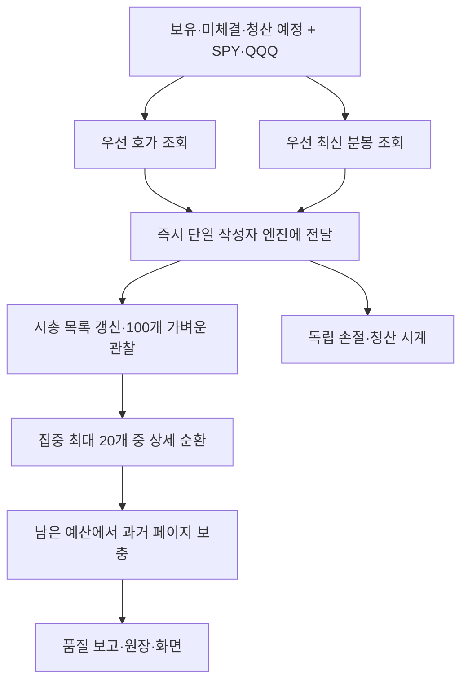

> **과거 기록** · 작성 당시의 기획·구현을 보관한 문서입니다. 현재 프로젝트는 [소개](../../../README.md)와 [시작 안내](../../GETTING_STARTED.md)를 먼저 읽어 주세요.

# 단계 02 — 시세·거래 자격·RVOL 데이터 품질

기준은 단계 01 `7610f63` 이후의 실제 코드다. 구현 대상은 PAPER_LOCAL의 입력 검증·기록·조회 순서·품질 보고다. 주문 체결 방식·전략 최적화·LLM·실주문 연결은 변경하지 않았다. **코드와 합성/모의 HTTP/격리 DB 검증은 완료했지만 실제 계좌 적격성과 거래량 비교 근거 확보는 부분완료다.** 단계 01의 검증된 시총 공급 자료 미연결도 그대로 유지한다.

## 공식 명세에서 확인한 범위

2026-11-14 [토스 공식 OpenAPI JSON](https://openapi.tossinvest.com/openapi-docs/latest/openapi.json), 버전 1.2.28을 다시 내려받아 확인했다. 실계좌 API 호출이나 주문 시험으로 기능을 추측하지 않았다.

| 입력·주장 | 실제 필드/명세 | 이번 처리 |
|---|---|---|
| 상장 시장·통화 | `StockInfo.market`, `currency` | USD·허용 미국 시장일 때 상장 참조 정보로 기록 |
| 상장 상태 | `status`: ACTIVE/SCHEDULED/DELISTED | 예정·폐지는 제한 근거. ACTIVE는 계좌 거래 가능을 증명하지 않음 |
| 미국 거래정지 | `stocks` 설명에는 언급되지만 미국 응답 스키마·예제에는 증명 필드 없음 | `halted=None`. 국내 `koreanMarketDetail`을 미국에 적용하지 않음 |
| 소수점·계좌별 거래 가능 | 종목별 지원 조회 필드를 확인하지 못함 | `fractional=None`, `tradable=None`, 계좌 범위 UNKNOWN |
| 일반 금액/소수점 주문 문법 | 주문 명세에는 US MARKET 금액 매수·소수점 수량 매도·정규장 종료 1시간 전 제한 존재 | API 전체 기능 설명과 해당 계좌/티커의 주문 자격을 구분. 시험 주문으로 확인하지 않음 |
| 매수 가능 현금 | `buying-power.cashBuyingPower` | 현금 존재를 개별 종목 주문 자격으로 사용하지 않음 |
| 매수 유의사항 | `warnings`: 정리매매·과열·VI 등. 빈 배열은 해당 활성 유의사항 없음 | 빈 배열을 미국 정지 없음·분할 없음으로 해석하지 않음. 새 반복 호출을 추가하지 않음 |
| 기업행동·분할 | 적용 기간·분할 계수·미국 기업행동 원장 없음 | `corporate_action=None`, 거래량 비교 가능성 UNKNOWN |
| 호가 | USD, nullable timestamp, 양쪽 가격·잔량 | 제공/수신 시각·양수 유한 가격·역전·미래·정수 잔량 검사. 잘못된 응답 거부 |
| 1분봉 | 종료 시각, OHLC, volume, currency, `nextBefore` | 확정 분 경계·수신 이후 사용·통화·정수 거래량·OHLC 검사 |
| 봉 거래소 | Candle에 거래소 필드 없음 | 분봉에서 거래소를 만들지 않음. 별도 StockInfo 관측만 사용 |
| 수정 정책 | `adjusted`: 수정주가 여부만 설명 | 요청은 기존처럼 `false`, `price_adjustment=raw`. 거래량도 분할 조정된다고 가정하지 않음 |
| 거래 없는 분 처리 | 0분 제공/생략의 보장이 명시되지 않음 | 실제 0분은 보존. 생략된 분은 누락으로 보고하며 보간하지 않음 |
| 역사적 깊이·최종 정정 | 페이지당 최대 200, `before` inclusive, `nextBefore` 그대로 전달 | 20일 제공 깊이·최종 정정 여부는 계좌 응답으로 추가 확인 필요 |

토스 명세의 Market Data는 `MARKET_DATA`와 `MARKET_DATA_CHART`를 나누며, Stock Info는 영업일 단위 참조 정보를 세션 진입 시 캐시하라고 권고한다. 기존 공용 1 TPS 제한을 유지한다. 명세만으로 사용자별 정확한 한도·데이터 이용료를 확인하지 못했으므로 **요금은 `null`, 계좌 한도 검증은 false**다. 표준 숫자형 RateLimit 헤더가 있으면 관측값만 기록한다. 임의 응답 헤더·토큰·오류 원문·계좌 식별자는 기록하지 않는다. 새 공급자 가입·결제를 시작하지 않았다.

## 적격성의 근거와 유효기간

`market/eligibility.py`가 StockInfo를 `InstrumentEligibility`로 정규화한다. 기존 불리언 필드는 호환을 위해 유지하고 다음 필드를 추가했다.

- `checked_at`: 실제 원본 수신 시각. 캐시를 읽을 때 현재 시각으로 덮어쓰지 않는다.
- `valid_until`: 관측의 만료 시각. StockInfo는 최대 하루 캐시하지만 신규 주문 검사의 기존 60초 신선도 제한도 계속 적용한다.
- `account_scope`: 실제 토스 종목별 계좌 검증 수단이 없으므로 UNKNOWN. 계좌번호나 API 키를 넣지 않는다.
- `field_evidence`: 항목별 출처·값·확인 상태·수신 시각·만료·원본 기준 시각·범위. StockInfo의 원본 갱신 시각은 미제공이므로 `as_of_at=null`이다.
- `volume_evidence`: 비교 범위·원본 제공처·가격/거래량 조정 정책·분할 확인 출처·확인 시각·만료의 별도 계약. 실제 토스 어댑터는 이를 임의 생성하지 않는다.

`run`의 엄격 검사는 출처·유효 시각·계좌 범위가 맞는 개별 근거 없이 불리언만 True인 자료를 승인하지 않는다. 외부 RVOL 숫자에 `verified=true`를 붙인 것만으로도 승인하지 않는다. 반면 손절·당일 청산에 신규 진입 자격을 요구하지 않으며 기존 보유 관리 경로를 유지한다.

사용자 확인 절차는 다음과 같다. 토스 앱의 해당 종목 소수점 거래 가능 안내와 실제 계좌 제한을 먼저 확인하고, [Open API 안내](https://openapi.tossinvest.com/)를 통해 **해당 계좌/티커의 매수·소수점·정지 상태를 증명하는 읽기 전용 API, 필드 의미, 갱신 시각**을 문의한다. 답변과 공식 근거를 확보한 뒤 어댑터를 추가해야 한다. 앱 화면 확인만으로 자동 통과 플래그를 만들지 않는다. 다른 증권사의 `tradable/fractionable`도 토스 계좌의 자격 증거가 아니다. 기업행동·분할은 적용일·계수·정정 이력과 거래량 조정 정의를 제공하는 허가된 공급원이 별도로 필요하다. 이 문서에서 아직 선정하지 않은 공급자의 비용·지원 기능을 확정하지 않는다.

## 분봉·RVOL 검증

원본 `Bar`에 `source`, `price_adjustment`를 추가했다. 토스 파서는 제공처와 raw 정책을 명시하며 기존 기록은 UNKNOWN 기본값으로 읽는다. 이벤트·주문·봉 식별자 규칙은 바꾸지 않는다.

`market/quality.py`는 거래소 달력에 따라 현재까지 확정될 수 있는 분을 계산하고 다음을 보고한다.

- 실제 수신한 1분 수, 누락 수/비율·대표 누락 시각, 명시적 거래량 0분 수.
- 동일 값 반복과 충돌하는 정정본 수. 정정본 중 하나를 임의로 선택하지 않는다.
- 최신 봉 시각·최초 수신 시각·수신 지연·현재 데이터 나이.
- 기대 5분/15분봉 수, 완전한 집계봉 수와 확보율. 휴장·DST·조기 폐장을 반영한다.

거래량 또는 잔량 `1.5`를 `int(float(...))`로 1로 바꾸지 않는다. 현재 정수 모델로 표현할 수 없으면 응답을 거부하고 미확인으로 남긴다. 미완성/미래 봉은 제외 횟수를 기록한다. 빈 응답·잘못된 페이지 커서·호가 역전·비정상 숫자도 별도로 확인할 수 있다.

RVOL은 최근 확정 5분 경계를 기준으로 **당일 개장부터 그 경과 분까지의 누적 거래량 ÷ 직전 20개 비교 가능 거래일의 같은 경과 분 누적 평균**이다. 조기 폐장으로 해당 경과 분에 도달하지 못한 과거 거래일만 달력에 따라 제외한다. 나머지 최근 거래일이 누락되면 더 오래된 완전한 날로 대체하지 않는다.

`rvol_report()`는 거래일별 필요/누락/정정 분 수와 다음 부족 사유를 제공한다.

| 코드 | 의미 |
|---|---|
| `current_closed_interval_missing` | 현재 확정 비교 경계 없음 |
| `current_session_coverage_incomplete` | 현재 개장 이후 누락 존재 |
| `historical_same_minute_coverage_incomplete` | 직전 20일의 동일 경과 분 자료 부족·충돌 |
| `split_volume_comparability_unknown` | 분할 전후 거래량 비교 범위·출처·조정 정의 미확인/만료 |
| `invalid_or_zero_history_volume` | 유효한 비교 평균 생성 불가 |

계산 경계 `current_time`과 실제 판단 시각 `observed_at`을 분리했다. 예를 들어 10:05 종료 후 10:05:02에 받은 과거 페이지는 10:05:02 이후의 판단에는 사용할 수 있지만 10:05:00의 과거 판단에는 사용할 수 없다. 기존 함수 호출은 `observed_at` 생략 시 이전처럼 경계 시각을 사용한다. 합성 테스트에서만 검증된 비교 근거를 구성하며 운영 어댑터가 이를 복사하지 않는다.

## 우선 수집과 과거 페이지 보충



위험 자료를 후보 탐색 완료까지 배치에 붙들어 두지 않고 콜백으로 먼저 전달한다. 우선 호가도 마지막 시도 시각을 저장하여, 예산보다 우선 종목이 많으면 다음 주기에 미조회를 먼저 시도한다. 후보 종목은 기존 공정 순환을 유지한다. 모든 네트워크 장애·느린 위험 요청까지 성공을 보장하는 것은 아니다. 발생한 지연은 표시하고 오래된 호가로 신규 진입하지 않는다.

후보 요청에는 주기 시작 후 기본 15초의 선택 작업 마감과 호출당 최대 5초의 읽기 대기를 적용한다. 위험 요청은 이 선택 작업 마감 때문에 건너뛰지 않는다. 따라서 위험 요청 자체의 API 지연이 길면 전체 주기는 15초를 초과할 수 있다. 실측 주기·우선 전달 시각·요청별 대기 시간·성공/오류·읽기 시도 수를 기록한다. 기존 공용 1 TPS와 429 Retry-After·최대 24회 읽기 예산을 유지한다. 읽기 시도는 취소 전에 예약한 것도 보수적으로 차감하므로 실제 네트워크 도달 횟수보다 많을 수 있다. OAuth와 별도 계좌 모니터 읽기는 이 시장 수집 주기 예산 밖이며 같은 클라이언트의 속도 제한을 공유한다.

과거 봉은 `history_pages_per_cycle: 1`로 최대 1페이지씩, 최신/우선 조회를 마친 뒤 남은 시간·호출 예산에서 보충한다. `0`으로 끌 수 있다. `nextBefore`와 페이지 수·최종 시도/수신·가장 오래된 시각을 PAPER 제어 원장에 저장해 재시작 후 복구한다. 최신 페이지 최대 200개로 20일이 확보됐다고 주장하지 않는다. inclusive 경계 중복은 기존 값과 비교해 합치고, 커서가 전진하지 않으면 CURSOR_STALLED로 중단한다. 마지막 페이지나 45일 관찰 범위 도달은 페이지 보충 종료일 뿐 20일 완전성·기업행동 검증 완료가 아니다. 실제 분봉은 기존 시장 원장에 보존한다.

`symbols_per_cycle`은 여전히 후보 상세 순환 수이고, 보유·ETF는 별도다. 예산 8처럼 작은 설정에서는 위험 자료가 먼저 사용하므로 후보 조회가 여러 주기에 걸릴 수 있다. 1단계의 테스트도 이 우선순위 변화에 맞춰 위험 봉·호가 확보와 후속 후보 순환을 함께 검사하도록 변경했다. 통과 조건을 없애지 않았다.

## 실행과 품질 보고

기존 `config/sessionquant.yaml`을 덮어쓰지 않았다. [설정 예시](../../../config/sessionquant.watchlist.example.yaml)에 새 기본값을 적었다. `run`은 시작 버튼 전까지 신규 매수를 대기하며 실제 주문을 실행하지 않는다.

```powershell
# 설치·주문 비활성화 점검: 외부 API 호출 없음
.\venv\Scripts\python.exe -m sessionquant doctor

# PAPER_LOCAL 운영. 검증 시총 파일·키·로컬 MySQL은 기존 설정 사용
.\venv\Scripts\python.exe -m sessionquant run --config config/sessionquant.yaml

# 다른 터미널에서 저장된 보고서만 조회: 주문·시세 API·LLM 호출 없음
.\venv\Scripts\python.exe -m sessionquant market-data-status
```

보고서는 `market_data_quality_v1` 제어 키에 저장한다. 대상은 현재 집중 후보+보유/열린 주문/청산 의도이며, 아직 상세 조회하지 않은 대상도 분모에 남긴다. `eligibility_unverified`, `relative_volume_unknown_or_low`, `quote_stale` 등 차단 종류별 종목 수와 6가지 확보율을 기록한다. SPY·QQQ의 봉 품질은 별도로 제공한다. 확보율 변화는 한국어 운영 로그로 남긴다. 거래 자격 미확인은 데이터가 없다는 뜻이며 거래 부적격 확정과 다르다.

화면은 종목 현황에 품질 표를 추가하며 기존 메인·실계좌 표시를 유지한다. 보고서의 원래 평가 시각을 표시하고 30초 경과·새 확정 분 미평가·근거 만료 시 오래된 성공을 현재 확보율로 세지 않는다. 합성 자료는 경고로 구분한다. 시총 자료가 없어 집중 후보가 0개이면 확보율은 100%가 아니라 '미평가'다. 우선 ETF의 기록은 계속 확인할 수 있다.

사용자 로컬에서 선택적으로 실제 읽기 검사를 하려면 실행 중인 토스 수집기를 종료한 뒤 아래를 실행한다. 새 토큰 발급이 기존 토큰을 무효화할 수 있어 다른 수집기와 병행하지 않는다.

```powershell
.\venv\Scripts\python.exe -m sessionquant check-toss --symbol AAPL
```

이 명령은 인증·한 종목 시세 읽기 검사다. 소수점 주문 자격·20일 이력·RVOL 검증 완료를 의미하지 않는다. 응답 지연·429·RateLimit 헤더와 사용자 계정의 실제 이용료는 별도로 확인한다. 이번 개발에서는 실제 `check-toss`·실계좌 연결·유료 LLM을 호출하지 않았다.

## 호환·보안·남은 차단

- DB 테이블/식별자는 그대로이며 JSON의 선택 필드와 새 제어 키만 추가한다. 기존 MySQL/SQLite 자료를 삭제·초기화하지 않는다.
- 기존 Bar 메타데이터 부재는 UNKNOWN으로 복구한다. 같은 OHLCV의 재조회로 최초 수신 시각을 새로 만들지 않는다. 근거가 부족한 예전 자료로 비교 가능성을 자동 승격하지 않는다.
- `run`은 엄격 검증을 항상 사용한다. 이전 PAPER 장부는 이 정책으로 복구할 수 있지만 엄격 정책을 저장한 장부를 이전 완화 정책으로 복구하는 것은 거부한다. 별도 연구 DB를 사용한다.
- 기존 `demo/replay/backtest`의 기본 연구 경로는 호환 정책을 유지한다. 합성 또는 이전 스칼라 RVOL 검증을 실데이터 검증 성과로 주장하지 않는다. 실제 재생·비교 확대는 단계 05의 범위다.
- LIVE_LOCAL·실주문 어댑터·주문 활성화 조건을 변경하지 않았다. 계좌 범위 UNKNOWN을 사용자 체크박스·파일의 단순 불리언으로 통과시키는 운영 경로를 만들지 않았다.
- 실제 시총 공급 자료, 토스 미국 종목/계좌 자격, 미국 정지·기업행동/분할 원장, 20일 분봉 깊이·수신 지연·거래량 정수 단위/0분 정책은 외부 검증 필요다. 자료 부족을 감추기 위해 위험 조건을 완화하지 않았다.

## 검증 추적

| 범위 | 자동 검사 |
|---|---|
| ACTIVE/국내 필드/임의 키로 미국 자격 승격 금지 | `test_market_data_quality.py` 적격성·모의 HTTP |
| 계좌 범위·시각·만료·불리언 근거 분리 | 동일 파일의 엄격 검사·복구 검사 |
| 누락·명시적 0·중복·정정·미완성·역전·커서 | 분봉 품질·파서·HTTP 테스트 |
| DST·휴장·조기 폐장 | 품질 달력 및 기존 `test_relative_volume.py`, `test_session_market.py` |
| 20일 동일 분·수신 후 사용·분할 비교 근거 | RVOL 보고서의 완전/누락/정정/미확인/조정 혼합 검사 |
| 후보보다 위험 자료 선전달·403/429·예산·재시작 | 새 수집기 검사·`test_watchlist_source.py` |
| 미조회 대상 분모·보고서 만료·합성 화면 | 보고서·Streamlit AppTest |
| MySQL JSON·출처·적격성·엄격 복구 | 격리 `test_mysql_integration.py` |

실행 결과와 전체 변경 파일은 아래 검증 기록에 정리한다.

### 변경 파일

| 영역 | 파일 |
|---|---|
| 품질·적격성·보고 | `sessionquant/market/quality.py`, `eligibility.py`, `reporting.py`, `engine.py`, `scanner.py` |
| 원본·수집·RVOL | `sessionquant/models.py`, `sessionquant/collectors/toss_market.py`, `sessionquant/market/source.py`, `sessionquant/scanners/relative_volume.py` |
| 운영·설정·CLI | `sessionquant/session_runtime.py`, `sessionquant/session_engine.py`, `sessionquant/session_config.py`, `sessionquant/cli.py`, `config/sessionquant.watchlist.example.yaml` |
| 화면 | `sessionquant/dashboard/session_app.py`, `sessionquant/dashboard/market_quality_panel.py` |
| 테스트 | `tests/test_market_data_quality.py`, `tests/test_watchlist_source.py`, `tests/test_mysql_integration.py` |
| 안내 | `README.md`, `docs/SESSIONQUANT_CURRENT.md`, `docs/STAGE01_WATCHLIST.md`, `docs/STAGE02_MARKET_DATA.md` |

### 2026-11-14 검증 결과

- 변경 전 기준선: `python -m pytest -q` — 673개 통과, 선택 MySQL 9개 제외, 실패 0.
- 최종 `python -m pytest -q` — **격리 MySQL 8을 포함한 727개 통과, 실패 0, 제외 0**(44.76초). 기존 pandas 시간대 변환 경고 8개는 남아 있다.
- `python -m ruff check sessionquant tests`, `git diff --check` — 통과.
- `python -m sessionquant doctor`, `python -m sessionquant market-data-status --help` — 통과. Python 3.12, PAPER_LOCAL, 실제 주문 비활성화 확인.
- 격리 SQLite의 `market-data-status` — 미평가 분모 0을 100%로 표시하지 않고 비율 `null`, 주문 쓰기·LLM 호출 0 반환.
- wheel 빌드와 소스 폴더 밖에서 설치 파일의 새 모듈·`doctor` 실행 — 통과.
- 모의 HTTP만으로 403·429·역전·잘못된 커서·임의 자격 키를 검사했다. 실제 사용자 토스/뉴스 API나 사용자 PC MySQL에는 접근하지 않았다. MySQL은 전용 컨테이너의 무작위 네임스페이스만 사용하고 검사 뒤 종료했다.

**판정: 부분완료.** 품질 계층·엄격 진입 차단·우선 전달·제한적 역사 페이지 수집·기록/복구·화면·자동 검증은 완료했다. 실제 토스 계좌 자격·미국 기업행동/분할 거래량 비교 근거·20일 이력 깊이·한도/요금/실측 지연 및 단계 01 시총 공급 자료는 미검증/미확보다. 검증된 근거 없이 실데이터 Paper 진입을 허용하거나 단계 02 실사용 완료를 선언하지 않는다. 다음 단계의 운영 검증은 이 입력 확보 전까지 보류한다. 단계 03~10 기능은 이번에 구현하지 않았다.

단계 03 이후에는 [Paper 체결 모델·장부 분리 안내](STAGE03_PAPER_FILLS.md)를 함께 따른다. 엄격한 시총·적격성·RVOL 진입 차단은 그대로 유지하며 체결 모델 변경을 이유로 완화하지 않는다.

## 최신 개정 보완 — 시장 참고 ETF

SHY·IEF·TLT·USO·SPY·QQQ 관측을 거래 100·집중 20과 분리했다. 보유·미체결·청산 대상 호가와 봉을 먼저 전달한 뒤 같은 토스 클라이언트의 남은 호출 예산만 사용한다. 참고군은 주기당 최대 2회, 현재가 30초·호가 60초·분봉 180초라는 초기 가정을 사용한다. 예산·선행 작업·공급자 한도에 따라 실제 주기는 길어질 수 있다. 휴장·정규장 밖에는 새 관측을 만들지 않는다. 분봉은 원본 Decimal 문자열로 받고 청크별 저장 사이에 청산 시계가 실행될 수 있도록 한다.

```yaml
# 기존 PAPER 설정에 선택적으로 추가. 실시간 권한 활성화 설정이 아니다.
market_reference:
  enabled: true
  price_seconds: 30
  candle_seconds: 180
  calls_per_cycle: 2
```

관측 모듈에는 주문·계좌 자격 인터페이스가 없다. 공급자 응답 성공은 개별 ETF의 해당 엔드포인트 조회 관측일 뿐, 계좌 실시간 이용 권한의 증명이 아니다. 운영 기본 권한 증거는 미등록이므로 `UNKNOWN_LATENCY`로 기록하며 검증된 15·30분 변화율로 승격하지 않는다. 사용자 파일의 임의 불리언을 실시간 권한으로 등록하는 운영 CLI는 제공하지 않는다.

원본 시각·수신·적재·사용 가능 시각·만료·지연 구분·통화·품질·원시/비교 가능성·출처 증거를 저장한다. 원본 시각 누락은 `null`, 15분 지연 자료는 수신이 지금이어도 지연 자료다. 동일 원본의 재조회는 최초 수신 시각을 유지하며, 같은 시각의 다른 값은 미해결 정정으로 격리한다. 최근 계산 캐시만 120봉으로 제한하고 원본 SQL 원장은 삭제하지 않는다. 정확한 첫 분봉이 수집된 경우 개장 가격은 별도로 보존한다. 중간 시각 누락·0거래량·만료·비교 가능성 미확인은 유효 창으로 사용하지 않는다.

1·5·15·30분 ETF 가격 등락률·변동성과 호가 스프레드를 Decimal로 계산한다. 일중 가격·전일 종가·개장 가격은 원시 값이며, 배당·분할 등을 확인하지 못한 일간 비교는 `UNKNOWN`이다. 과거에 이미 끝난 봉을 지금 수집했더라도 사용 가능 시각은 지금이다. 완전한 시계열·별도 권한 및 기업행동 비교 근거가 있어야 계산 창이 `GOOD`이다. 정정 미해결 구간은 사용하지 않는다.

FRED DGS2·DGS10·DCOILWTICO는 기존 별도 배경 작업의 일별 참고 자료다. `observation_date`, 실제 수신 시각, 조회 기준일과 vintage 날짜를 분리하며 실제 발표·수정 시각은 확인되지 않으면 `null`이다. 기존 `macro_indicators` 식별자는 유지한다. 미래 자료로 사용 가능 시각을 소급하지 않는다.

SQLite 스키마 버전 3, MySQL 이력 버전 3에 `market_reference_observations`, `market_reference_metrics`, `fred_reference_observations`를 추가한다. MySQL 실제 테이블은 `pq_` 접두사와 네임스페이스·기록 해시·수집 시각 인덱스를 사용한다. 기존 주문·이벤트 ID·Decimal 장부는 변경하지 않는다. 새 시계열은 자동 삭제 대상이 아니므로 장기 보존 정책은 추후 운영 검토가 필요하다.

기존 시장 탭에 참고 ETF 표만 추가했다. 전체 대시보드 재설계는 하지 않았다. 기존 `run` 설정과 `dashboard --db ...`를 사용하며 참고군은 매수 후보가 아니다. `watchlist_enabled: false`의 이전 연구 호환 경로에서는 이 별도 스케줄을 실행하지 않는다.

### 공식 문서 확인과 검증 한계

2026-11-14 공개 문서 GET으로 확인했다. 인증·유료 API·사용자 계좌 호출은 하지 않았다.

- [토스 OpenAPI 1.2.28](https://openapi.tossinvest.com/openapi-docs/latest/openapi.json): ETF/FOREIGN_ETF 유형·USD·현재가/호가 시각(누락 가능)·1분/일봉·원시 가격 필드 및 읽기 엔드포인트 확인. 개별 6종목 지원과 계좌 실시간 권한은 별도 미검증이다.
- [SHY](https://www.ishares.com/us/products/239452/ishares-13-year-treasury-bond-etf): 1~3년 국채, 정확한 2년물 금리가 아니다.
- [IEF](https://www.ishares.com/us/products/239456/ishares-710-year-treasury-bond-etf): 7~10년 국채, 정확한 10년물 금리가 아니다.
- [TLT](https://www.ishares.com/us/products/239454/ishares-20-year-treasury-bond-etf): 20년 초과 국채. 10년물 금리 대용으로 표시하지 않는다.
- [USO](https://www.uscfinvestments.com/uso): 선물 연계 노출. 롤오버·추적 오차가 있고 WTI 현물과 다르다.
- [FRED DGS10](https://fred.stlouisfed.org/series/DGS10): 일별 공식 기준 자료. ETF 변화율을 금리 bp로 환산하지 않는다.

토스 429는 해당 한도 그룹의 재시도 대기를 지킨다. 같은 그룹의 보유 호가도 공급자 제한을 받을 수 있으며, 이때 청산 시계가 계속 실행되는 것과 실제 주문·시세 성공을 구분한다. 데이터 장애는 청산 성공을 보장하지 않는다.

### 개정 02 결과

- 신규 참고 관측 검사: `python -m pytest tests/test_market_reference.py -q` — 35 통과. 정상·15분 지연·원본 시각 누락·중복·미래·통화·휴장·조기 폐장·DST·정정·분할/배당 비교 미확인·404/429·0거래량·보유 선전달·예산 축소를 합성 입력으로 검사했다.
- 실제 격리 MySQL 8 검사: `PQ_TEST_MYSQL=1 python -m pytest tests/test_mysql_integration.py -q` — 12 통과. 사용자 DB가 아닌 임의 네임스페이스를 사용했다.
- 최종 전체: 같은 격리 MySQL 환경의 `python -m pytest -q` — **801 통과, 실패·제외 0**, 기존 pandas 경고 8개(53.27초).
- Ruff·공백 오류 검사·wheel 빌드·소스 밖 wheel의 `doctor` 통과. 실제 주문·유료 LLM 호출 0.
- 이번 추가/변경 파일: `market_reference/{__init__,contracts,collector,metrics,settings,store}.py`, `dashboard/{reference_panel,session_app}.py`, `collectors/toss_market.py`, `market/{source,engine}.py`, `watchlist/{capitalization,selection}.py`, `session_config.py`, `session_runtime.py`, `database/{repository,mysql_repository}.py`, `macro/{sources,service}.py`, `tests/test_market_reference.py`, `tests/test_mysql_integration.py`, 본 문서와 `REVISION_00_04_AUDIT.md`.

**판정: 코드·모의/격리 DB 검증 완료, 실사용 검증 부분완료.** 기존 전략과 실제 주문 경로는 유지한다. 공급자·계좌·비교 가능성 검증은 UNKNOWN으로 남는다. 중대한 회귀 실패는 없어 승인된 04 보완을 진행할 수 있다. 05는 별도 승인 전 보류한다.
